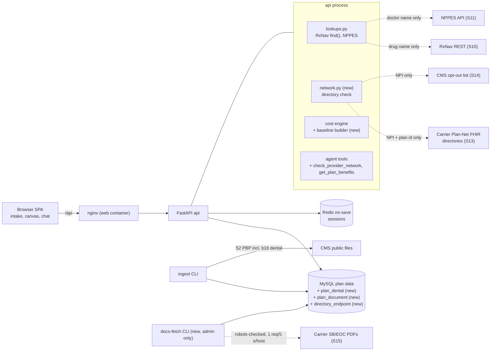
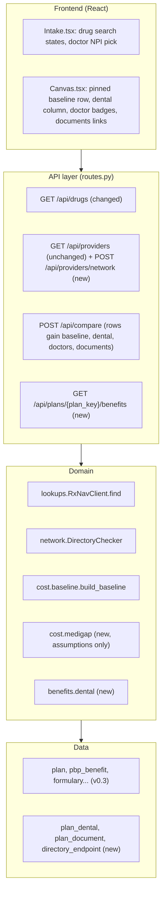
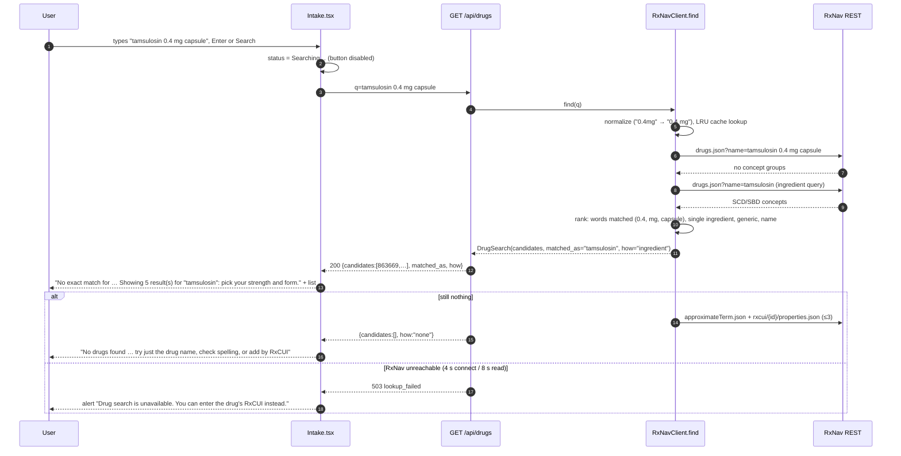
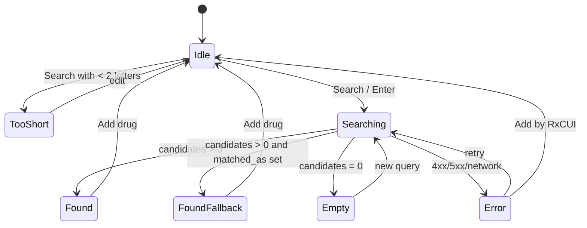
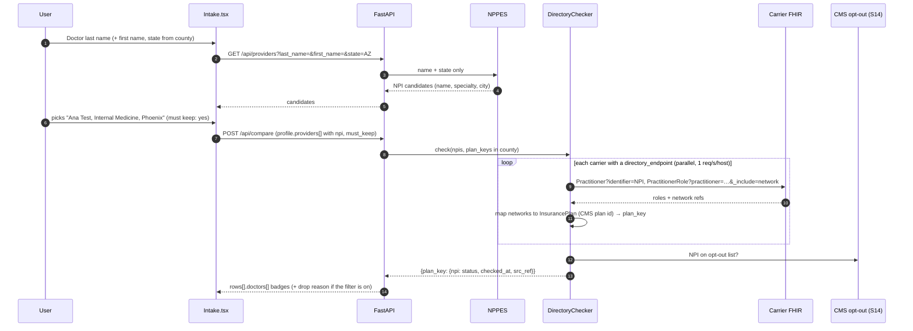
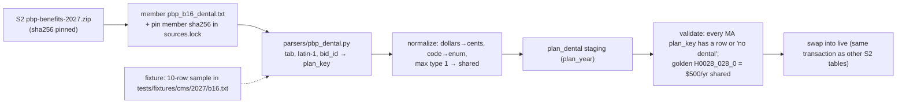
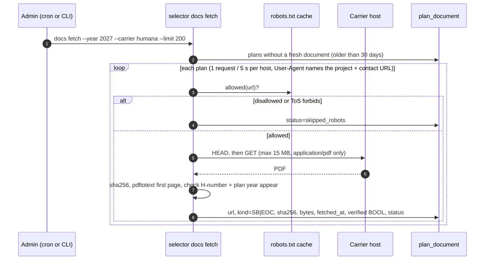
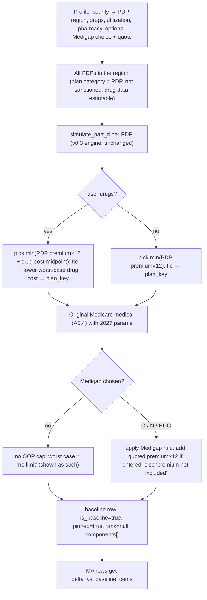

# Medicare Plan Selector: Design v0.4 Addendum (Thomas's test comments, 2026-11-19)

Status: **Draft for Thomas's sign-off.** Author: Philip. Date: 2026-11-19 (MST, America/Phoenix).
Base: Design v0.3 (`DESIGN.md`, signed off 2026-11-12) and branch `feat/mvp-wp2-8` at `10ee306`.
This addendum adds to v0.3; where it differs, the addendum wins. Section numbers below are `A1`–`A8`.

Thomas tested on ml3090 (UI on `http://192.168.0.216:8080`) and sent four comments:

| # | Thomas's comment | Answer in short | Section |
|---|---|---|---|
| 1 | "The drugs search has no response" | **Reproduced and fixed.** RxNav's name search returns nothing for a name plus strength and form ("tamsulosin 0.4 mg capsule"), and the form showed nothing for an empty result. Fixed on local branch `fix/drug-search` (commit `19111e0`), with tests. | A2 |
| 2 | "Would the entered Doctor field impact the search of plan?" | **Today: no.** The names are stored with the profile and nothing else reads them. v0.4 adds an NPI pick plus a directory check against each carrier's public CMS-mandated FHIR directory, shown as *listed / not listed / can't check*, with an optional filter. | A3 |
| 3 | "Should include the dental information if the plan included it. Try to look at each provider's sites for the plan detail" | **Yes.** CMS PBP file `pbp_b16_dental.txt` (S2, already downloaded by the ingest) has preventive/comprehensive dental cost sharing and annual maximums for every plan. Ingest it and show it. Carrier Summary of Benefits / EOC PDFs: **link them** (optional, cached, rate-limited fetch), CMS stays the source of truth. | A4 |
| 4 | "Always include the original Medicare + Part D as one standard" | **Yes.** A pinned baseline row, "Original Medicare + Part D (standard)", in every comparison: Parts A/B with 2027 amounts + the lowest-cost stand-alone PDP for the user's drugs, with an optional Medigap (G / N / high-deductible G) assumption. | A5 |

Status labels as in v0.3: **V** verified (opened or called on the date shown), **D** documented but not inspected, **U** unverified.

---

## A1. Changelog

| Version | Date | Change |
|---|---|---|
| v0.3 | 2026-11-12 | Signed off (no-save mode). |
| **v0.4 (draft)** | 2026-11-19 | This addendum: drug-search fix (A2), doctors/network directory check (A3), dental from PBP b16 + carrier documents (A4), pinned Original Medicare + Part D baseline (A5), 2027 Part A/B amounts now **V** (A5.2), new API fields (A6), work packages WP9–WP14 and tests (A7, `IMPLEMENTATION-PLAN.md`), open decisions OD-12 to OD-21 (A8, `OPEN-QUESTIONS.md`). |

### A1.1 Architecture after v0.4



### A1.2 Software layers touched



---

## A2. Item 1: drug search "has no response"

### A2.1 Reproduction (box, 2026-11-19 ~15:10 MST)

Stack: dev MySQL/Redis containers, `make dev-data` (plan data for 2027: ready), `make api-dev` on 127.0.0.1:8000 and the
Vite dev server on :5173 (which proxies `/api` the same way nginx does). Live RxNav. A No-save session was created
with `POST /api/session`, then `GET /api/drugs?q=…` was called directly and through the proxy.

| Query (Thomas's case first) | RxNav `drugs.json?name=` | `/api/drugs` before the fix | Through the proxy |
|---|---|---|---|
| `tamsulosin 0.4 mg capsule` | `{"drugGroup":{"name":null}}`, **no concept groups** | `200 {"candidates":[]}` in 0.49 s | same, 5 ms (cached) |
| `Tamsulosin 0.4mg` | empty | `200 {"candidates":[]}` | same |
| `tamsulosin` | 5 SCD/SBD concepts incl. **863669** | 200, 5 candidates (combination product first) | same |
| `flomax` | 1 SBD (863671) | 200, 1 candidate | same |
| `t` | – | `422` (min length 2) | same |

RxCUI check: `GET /REST/rxcui/863669/properties.json` → `tamsulosin hydrochloride 0.4 MG Oral Capsule`, TTY **SCD**
(**V**, 2026-11-19). RxNav's `approximateTerm.json?term=tamsulosin 0.4 mg capsule` ranks 863669 first (**V**).

The intake form (`Intake.tsx`, before the fix) did `setCands(candidates)` and rendered the list **only when it was
non-empty**. There was no "searching" state and no "no matches" message, and the error text went to the general
error line at the bottom of the form. Pressing **Enter** in the drug box submitted the whole form ("Compare plans")
instead of searching.

### A2.2 Root causes

1. **Primary (reproduced):** RxNav `drugs.json` matches drug *names* (ingredient/brand); it does not parse strength or
   dose form. A query such as "tamsulosin 0.4 mg capsule", the way people read it off the bottle, returns zero
   concepts, so the API correctly but unhelpfully returned `[]`.
2. **Primary (reproduced):** the UI rendered **nothing** for `[]`: no message, no loading indicator. Together with 1,
   this is exactly "no response".
3. **Contributing:** Enter in the drug field submitted the form; the 1-letter case returned silently.
4. **Contributing:** lookups used a 15 s timeout and a 1 s per-process spacing. On a host where outbound HTTPS is
   blocked or slow, a click shows nothing for up to 15 s before an error.

Not the cause (checked): CORS (the SPA calls same-origin `/api`), the Vite/nginx proxy path (identical answers),
the non-localhost bind (`MSP_WEB_BIND` only changes the published address), the dev dataset (drug search doesn't read
plan data; note that RxCUI 863669 is **not** in the committed dev formulary sample, so with `make ingest-dev` data every
plan will show tamsulosin as "not on formulary". Real `make ingest` data is needed to judge coverage).

### A2.3 Likely ml3090-specific causes still to rule out (not reproducible on the box)

| Check on ml3090 | Command | If it fails |
|---|---|---|
| The api **container** can reach RxNav | `docker compose exec api python -c "import httpx;print(httpx.get('https://rxnav.nlm.nih.gov/REST/version.json',timeout=5).status_code)"` | The UI now shows "Drug search is unavailable. You can enter the drug's RxCUI instead." Fix the host firewall/proxy, or set `HTTPS_PROXY` for the api service. |
| Container DNS works | `docker compose exec api getent hosts rxnav.nlm.nih.gov` | Docker daemon DNS (`/etc/docker/daemon.json` `"dns"`). |
| Lookups are not switched off | `make app-logs` shows `503 lookup_unavailable` | Only tests build the app with `lookups=False`; production always has them. |
| The browser has the new bundle | Hard-refresh after `make app-up` | Old SPA still has the silent empty state. |

### A2.4 Fix design (implemented on `fix/drug-search`, `19111e0`)



UI states (all announced through an `aria-live` status line, so screen readers hear them too):



Rules:
- Fallback order: exact name → ingredient name (strengths, units and dose-form words removed) → RxNav approximate match
  (typos), at most 3 property calls. Only SCD/SBD/GPCK/BPCK concepts (priceable products) are returned.
- Ranking (deterministic): most query words found in the concept name, then single-ingredient before combinations,
  then generic (SCD/GPCK) before brand, then name. For the full string, **863669 is first**.
- RxNav spacing 0.1 s per process (NLM's published limit is 20 requests/second per IP, S10); timeouts 4 s connect,
  8 s read. Cache stays in process memory and holds only drug-name → RxCUI (no user link, v0.3 §8.5).
- Nothing about the drug is logged (unchanged).

### A2.5 Tests (added)

| ID | Test | File |
|---|---|---|
| D1 | Normalization and ingredient query (5 cases incl. "0.4mg", "HCl", "potassium chloride 10 meq ER tab") | `tests/unit/test_drug_search.py` |
| D2 | **Full string "tamsulosin 0.4 mg capsule"** → `how=ingredient`, `matched_as=tamsulosin`, **863669 first**, exactly 2 RxNav calls | same |
| D3 | **Partial "tamsulosin"** → `how=exact`, 863669 present, generic before brand, combinations last, IN concept dropped | same |
| D4 | "Tamsulosin 0.4mg capsule" (glued strength) → 863669 first | same |
| D5 | Typo → approximate match, duplicate RxCUIs fetched once | same |
| D6 | Nothing found → `how=none`, second call served from cache | same |
| D7 | Connect timeout → `LookupError_` | same |
| D8 | Agent tool's `search()` keeps its list API | same |
| D9 | `GET /api/drugs` full/partial/none/422 against the compose stack | `tests/integration/test_api_drugs.py` |
| D10 | RxNav outage → `503 lookup_failed` | same |
| D11–D16 | UI: fallback note + 863669 first; Enter searches and doesn't submit; empty message; 503 alert with RxCUI hint; "Searching…" while in flight; 1-letter message | `frontend/src/Intake.test.tsx` |

`make test` after the fix: backend **319 passed**, frontend **33 passed**, lint/mypy/prettier clean, pre-commit clean.

---

## A3. Item 2: does the Doctor field affect the plan search?

### A3.1 What it does today (from the code at `10ee306`)

- `Intake.tsx` keeps a free-text **name** per doctor (`providers: [{name}]`), up to `MAX_PROVIDERS=15`. The UI never
  calls `GET /api/providers`, so no NPI is attached.
- `Profile.to_cost_profile()` does **not** pass providers to the cost engine; `drop_reason`, `rank` and
  `compare_plans` never read them. The model sees only `doctor_count` (`summary_for_prompt`).
- The agent tool `lookup_provider` finds NPIs through NPPES and always returns `network_status: "unknown"`.
- Policy (`agent/policy.py`) blocks any sentence claiming a doctor is in network.

So **the Doctor field has no effect on which plans are shown or how they rank.** It only feeds the checklist text
("Call each plan to confirm your doctors"). The hint under the field says so.

### A3.2 What v0.4 changes

CMS-9115-F (2020 Interoperability and Patient Access rule) requires every MA organization to run a **public Provider
Directory API** with no user authentication (42 CFR 422.120; CMS FAQ, S13). Most follow the HL7 Da Vinci **PDex Plan-Net**
FHIR profile, where `InsurancePlan` carries the CMS plan ID and links to network `Organization`s, and `PractitionerRole`
ties a practitioner (by NPI) to a network and location.

Spot checks on 2026-11-19 (**V** for the calls listed; coverage beyond them **U**):

| Carrier | Endpoint | Auth | What we saw |
|---|---|---|---|
| UnitedHealthcare | `https://flex.optum.com/fhirpublic/R4` | none | `/metadata` 200; `Practitioner?identifier=<NPI>` returned 2 entries; `InsurancePlan` carries `urn:cms:medicare-advantage-contract` = `H2406076000` and `network` references |
| Humana | `https://fhir.humana.com/api` | none | `/metadata` 200; `InsurancePlan` identifier `H3642-001-000-2027` + network references; `Practitioner?identifier=` returned 0 for a Phoenix NPI (search by identifier may be unsupported, **U**) |
| Aetna (CVS) | `https://apif1.aetna.com/fhir/v1/providerdirectory` | **app registration / client credentials** (developer portal) | Not called. CMS FAQ says payers may require an API key for the app, not the user. Needs Thomas to register (OD-14). |
| Others (BCBS plans, Devoted, Alignment, Wellcare/Centene, Banner, …) | per-carrier | mostly none | **U**: to be catalogued in `directory_endpoint` (WP13) |

Directory data is known to be imperfect, and a public directory proves *listing*, not that the doctor accepts new
patients or that a specific plan's tier includes them. So the honest output is a **listing status**, never "covered".

### A3.3 Statuses and wording

| Status | Meaning | Shown as (exact UI text) | Affects ranking? |
|---|---|---|---|
| `listed` | NPI found in a `PractitionerRole` whose network is linked to this plan's `InsurancePlan` | "✓ Listed in the plan's directory (checked Nov 19). Call to confirm." | Only through the optional filter or weight (below) |
| `not_listed` | Directory reachable, plan matched, NPI not linked to any of its networks | "Not found in the plan's directory (checked Nov 19). May be out of network: call the plan." | Same |
| `unknown` | Directory reachable but the plan or NPI couldn't be matched (no CMS plan ID, NPI search unsupported) | "Couldn't check this plan's directory. Call the plan." | No |
| `unavailable` | No public endpoint, needs registration, timeout or error | "This plan's directory can't be checked automatically. Call the plan." | No |
| `original_medicare` (baseline row) | Original Medicare has no network. NPI checked against the CMS **opt-out list** (S14) | "Original Medicare: any doctor who accepts Medicare. Not on the opt-out list (checked Nov 19)." / "Opted out of Medicare: you'd pay this doctor yourself." | Same as above |

Ranking rule (keeps v0.3 §6.3 neutrality, same rule for every plan):
- Default: **badges only**, no ranking effect.
- Optional must-have "Only plans that list all my must-keep doctors": drops plans with any `not_listed` must-keep
  doctor. `unknown`/`unavailable` are **never** dropped; they get "can't check" instead. Drop reason:
  "Your doctor *Dr. X* isn't in this plan's directory (checked Nov 19)."
- Optional weight `doctor_fit` (0 by default) = share of must-keep doctors `listed`; unknowns count 0.5.

### A3.4 Flow



### A3.5 Data and caching

- `directory_endpoint(org_marketing_name_pattern, contract_prefixes JSON, base_url, auth ENUM('none','app_key','unsupported'),
  plan_id_system, plan_id_format, notes, verified_at)`: curated, committed seed file `sources/directories.yaml`
  (public URLs only, no keys).
- `insurance_plan_map(plan_year, plan_key, endpoint_id, network_refs JSON, fetched_at)`: built nightly by
  `selector directories sync` from each `InsurancePlan` bundle (plan data, no user link).
- Practitioner results: **process-memory LRU only**, keyed by `(endpoint, npi)`, TTL 24 h, the same rule as the
  RxNav/NPPES caches: an NPI is the doctor's public identifier, not the user's, and nothing ties it to a session.
  In No-save mode nothing is written. In Saved mode the NPI is part of the encrypted `providers_enc` (v0.3).
- What leaves our server: NPI and plan IDs to carrier endpoints; never the user's ZIP, drugs or session.

### A3.6 Guardrails and agent

- Policy change: the blanket "never claim network status" becomes "state only a **listing status** returned by
  `check_provider_network`, with its date and 'call the plan to confirm'". The validator rejects "in network",
  "covered", "accepts your plan" unless the sentence carries a `listed` tool row.
- New tool `check_provider_network(npis[], plan_keys[]) → {plan_key: {npi: {status, checked_at, source}}}`.
- Checklist keeps "Call each plan to confirm your doctors" for every plan, including `listed` ones.

---

## A4. Item 3: dental benefits

### A4.1 What CMS publishes (S2 PBP Benefits 2027, **V** 2026-11-19)

`pbp-benefits-2027.zip` (already pinned in `sources.lock`, sha256 `6d8430e2…`) contains `pbp_b16_dental.txt`
(7,365 plan segments, 302 columns), `pbp_b16_b19b_dental_vbid_uf.txt` (VBID/UF variants), the SAS layouts and
`PBP_Benefits_2027_dictionary.xlsx`. Fields we need (dictionary sheet `pbp_step16`):

| Field(s) | Meaning (dictionary) | Example: H0028_028_0 (dev golden plan) |
|---|---|---|
| `pbp_b16a_*_mc_*` | 16a Medicare-covered dental (copay/coins) | $35 copay |
| `pbp_b16b_maxplan_pv_yn/_amt/_per` | 16b preventive: max plan benefit, amount, periodicity (3 = every year) | Yes, **$500**, every year |
| `pbp_b16b_bendesc_{oe,dx,pc,ft,ops}_*` and `copay_/coins_*` | Oral exams, X-rays, cleanings, fluoride, other: type (2 mandatory, 3 optional, 4 both), visit limits, copay/coins | exams/X-rays/cleanings $0 |
| `pbp_b16c_maxplan_cmp_yn/_type/_amt/_per` | 16c comprehensive: max (type 1 = shared with 16b, 2 = own amount) | Yes, type 1 (**shares the $500**) |
| `pbp_b16c_bendesc_{rs,end,peri,prm,prf,omsg,ags,impl}_*` | Restorative, endodontics, periodontics, prosthodontics removable/fixed, oral surgery, adjunctive, implants | 0–50% coinsurance; dentures 50% |
| `*_amo` = 3 | Optional supplemental (extra premium, enrolled separately) | – |

Counts across 2027 (**V**): 3,382 segments have a preventive maximum (3,345 yearly); 4,211 have a comprehensive
maximum, 3,352 of them shared with preventive; median separate comprehensive maximum $2,000. Stand-alone PDPs and
Original Medicare have **no routine dental** (Medicare.gov "Dental services", S16; Medigap doesn't add it).

### A4.2 Data model (new table, plan data, keyed by `plan_year` like v0.3 §5)

```
plan_dental(plan_year, plan_key, has_medicare_covered BOOL, has_preventive BOOL, has_comprehensive BOOL,
            preventive_max_cents NULL, preventive_max_period ENUM('year','2y','3y','6m','3m','month','other') NULL,
            comprehensive_max_cents NULL, comprehensive_max_shared BOOL NULL,
            optional_supplemental BOOL, services_json,   -- [{code:'oe', label:'Oral exams', copay_min/max, coins_min/max, limit_text}]
            src_ref, PRIMARY KEY(plan_year, plan_key))
```
`services_json` keeps the CMS free-text limits (`*_desc`, max 512 chars each) for display only.

### A4.3 Ingest



### A4.4 Compare view, cost engine, agent

- **Table:** a "Dental" column with a one-line summary, e.g. "Preventive $0 · Comprehensive 0–50% · Max $500/yr (shared)";
  "No routine dental" for PDPs and the baseline row; "Optional (extra premium)" when `optional_supplemental`.
- **Side-by-side:** a Dental section listing each service with its cost sharing and the CMS limit text, cited
  (`src_ref` S2 b16, vintage `2027-pbp-20261001`).
- **Must-have:** "Includes dental" (preventive at least) and optional "Dental max at least $X".
- **Cost engine:** dental is **not** added to the yearly total by default (no CMS price data for dental work).
  Optional "Dental use" preset (OD-16): `none | cleanings | major` adds an assumed allowed amount (U, labelled), capped by
  the plan maximum: shown as a separate line so the medical/drug totals stay comparable to v0.3.
- **Agent:** new tool `get_plan_benefits(plan_key, category='dental')` returning the `plan_dental` row with `src_ref`;
  the validator treats dental dollar amounts like any other tool number.

### A4.5 Carrier sites (Summary of Benefits / Evidence of Coverage)

MA organizations must post the current EOC, Summary of Benefits, provider directory and formulary on their website
by Oct 15 (42 CFR 422.2265 and 422.2267, S15, **D**). So every plan *has* these PDFs; the question is how reliably we
can find and read them.

Feasibility, checked 2026-11-19:

| Carrier | What we found | robots.txt | Reliability |
|---|---|---|---|
| UnitedHealthcare | 2027 SB PDFs on `content.medicareadvantage.com/2027/UnitedHealthcare-<code>-2027-SB_…pdf` (search results; the `<code>` is a marketing code, **not** derivable from the H-number) | `content.medicareadvantage.com`: allows all; `www.uhc.com` returned **403** to a script | Link: **medium** (needs a lookup page per plan). Parse: low |
| Humana | EOCs at `assets.humana.com/is/content/humana/H<contract><plan><segment>EOC27pdf` (search results, e.g. `H5216011000EOC27`) | `www.humana.com` robots allows general crawling; `assets.humana.com` has no robots.txt (404) | Link: **high** (URL pattern from plan_key, **U** until spot-checked per plan). Parse: low–medium |
| Aetna | Plan documents by plan/ZIP at `aetna.com/medicare/…/view-coverage-benefits` (search results) | present, with disallows to honour | Link: **low–medium** (interactive page). Parse: low |
| Others | per carrier | per carrier | **U** |

Honest conclusion:
- **Reliable:** CMS PBP data for dental and every other benefit (structured, every plan, one file). It stays the
  **only source for numbers** in the table, ranking and chat.
- **Reasonably reliable:** a **link** to the carrier's SB/EOC PDF for many plans, after we verify the URL resolves to a
  PDF that names the plan's H-number.
- **Not reliable:** automatically extracting benefit values from carrier PDFs (layouts differ by carrier and year,
  tables span pages). v0.4 does **not** extract numbers from PDFs. A later step may show extracted text side by side
  with the CMS value for a human to compare, labelled "From the carrier's PDF (fetched Nov 19), not checked by CMS".

Design (WP14, optional, after Thomas enrolls):



- `plan_document(plan_year, plan_key, kind ENUM('SB','EOC','ANOC','directory'), url, sha256, bytes, fetched_at,
  verified BOOL, status, src_ref)`. PDFs are kept on the server volume for re-verification only, **never committed**
  (the forbidden-files hook already blocks `data/`).
- Never in the user's request path; users only see stored links: "Summary of Benefits (carrier PDF, checked Nov 19)".
- Carrier data is **supplementary**: never overrides a CMS value; if a human-reviewed extract differs, the CMS value
  is shown with "The carrier's document differs: check with the plan".
- Respect robots.txt and each site's terms; stop for any carrier whose terms forbid automated access (OD-17).

---

## A5. Item 4: Original Medicare + Part D as the standard baseline

### A5.1 What it is

Every comparison gets one synthetic, **always-pinned** row:

> **Original Medicare + Part D (standard)**: Part A + Part B + the lowest-cost stand-alone drug plan (PDP) for your
> drugs in your region: *<PDP name>*. Optional: + Medigap *<G | N | High-deductible G>*.

Today (v0.3) the "original" path shows every PDP as its own row costed with Part B and 20% coinsurance, and the row
disappears when the user picks "Medicare Advantage". v0.4 keeps the per-PDP rows (they are the drug-plan choices for
this path) and adds the pinned summary row, which is shown on **every** path, never dropped by must-have filters (a
filter that it fails adds a note instead), and is the reference for "vs. standard" deltas on MA rows.

### A5.2 Parameters (2027)

| Item | 2027 | Source | Status |
|---|---|---|---|
| Part B standard premium | **$209.40/month** | Federal Register 2026-23601 (CMS-8094-N), 91 FR 74570, published 2026-11-19; CMS fact sheet 2026-11-17 | **V** |
| Part B deductible | **$292/year** | same | **V** |
| Part B coinsurance | 20% of the Medicare-approved amount | Medicare.gov / SSA §1833 | **V** (unchanged) |
| Part A inpatient deductible | **$1,776 per benefit period** | Federal Register 2026-23603 (CMS-8092-N), 2026-11-19 | **V** |
| Part A days 61–90 / lifetime reserve / SNF 21–100 | $444 / $888 / $222 per day | same | **V** |
| Part A premium | $0 for most (40+ quarters); $328 / $597 otherwise | same | **V** (assume $0, OD-19) |
| Part D standard deductible / OOP threshold | $700 / $2,400 | S6 (2027 Rate Announcement) | **V** (v0.3) |
| Part D base beneficiary premium | $41.33 | CMS 2026-07-28 bid announcement | **V** (reference only) |
| Medigap high-deductible F/G/J deductible | **$3,050** | CMS "Deductible amount for Medigap HD F, G & J, CY2027" | **V** |
| Medigap Plan N copays | up to $20 office visit, up to $50 ER (not admitted) | Medicare.gov "Compare Medigap plan benefits" | **V** (rules; current year text) |
| Medigap premiums | **no CMS data**; user-entered quote, AZ SHIP booklet as a reference link (S9) | – | **U** |
| Out-of-pocket cap | none without Medigap | Medicare.gov | **V** |

The code still carries the 2026 values (`part_b_premium_monthly_cents=20290`, `part_b_deductible_cents=28300`,
`PART_A_DEDUCTIBLE_CENTS=173600`, labelled "2026 placeholder"). WP10 moves them to a `medicare_params(plan_year, …,
src_ref)` row loaded with the ingest, with the values above for 2027.

### A5.3 How the baseline is costed



Rules:
- **Medical (no Medigap):** Part B deductible $292 + 20% of assumed allowed amounts above it (v0.3 presets), + Part A
  deductible $1,776 for each assumed admission (high preset: 1). No cap; worst case is "no limit" and the UI says so.
- **Medigap G:** user pays the Part B deductible only ($292); worst case = $292 + quoted premium.
- **Medigap N:** Part B deductible + $20 × office visits + $50 × ER visits not admitted (presets); Part B excess
  charges assumed $0 (labelled, U).
- **High-deductible G:** min(Original Medicare OOP, $3,050), Part B deductible counts toward it.
- **Premiums:** Part B $209.40 × 12 always (MA rows already include it); PDP premium; Medigap premium only if the
  user entered a quote, else the row says "Medigap premium not included: get a quote (SHIP can help)".
- **Neutrality:** the PDP inside the baseline is chosen only by estimated cost, the same formula for every PDP; the
  baseline is not ranked (rank `null`) so it never outranks or displaces a plan; the ranked list is unchanged.
- **Agent:** `compare_plans` returns the baseline under `baseline`; prompts say "Compared with the standard Original
  Medicare + Part D option…" and must cite its components.

### A5.4 Display

- First row of the table, with a "Standard" badge and a left border; can't be hidden or sorted away; side-by-side
  always includes it as the first column.
- Cells: monthly premium = Part B + PDP (+ Medigap if quoted); deductible = Part B $292 + PDP drug deductible;
  MOOP = "No limit" (or Medigap rule); drug coverage = from the chosen PDP; dental = "Not covered by Medicare";
  doctors = "Any doctor who accepts Medicare" (+ opt-out check).
- Notes: "You can switch PDP in the Original Medicare rows below." "Medigap: in most states you have a one-time
  open enrollment period; outside it, insurers may refuse or charge more (check with SHIP)" (Medicare.gov, **V** text; state
  rules **U**).

---

## A6. API reference (changed and new; everything else as in v0.3)

All endpoints need the session cookie from `POST /api/session` (v0.3). Errors use
`{"detail": {"code": str, "message": str}}`. Amounts are integer cents.

### `GET /api/drugs?q=` (changed, implemented)

| Param | Type | Rules |
|---|---|---|
| `q` | string | 2–80 chars; name, optionally with strength and form |

`200`:
```json
{"candidates": [{"rxcui": "863669", "name": "tamsulosin hydrochloride 0.4 MG Oral Capsule", "tty": "SCD"}],
 "matched_as": "tamsulosin", "how": "ingredient"}
```
`how`: `exact | ingredient | approximate | none`; `matched_as` is `null` for `exact` and `none`.
Errors: `422 invalid` (length), `503 lookup_unavailable` (lookups off), `503 lookup_failed` (RxNav unreachable, 4 s / 8 s).

### `GET /api/providers?last_name=&first_name=&state=` (unchanged; now used by the intake)

`200`: `{"candidates": [{"npi", "name", "specialty", "city", "state"}], "note": str}`.

### `POST /api/providers/network` (new, WP13)

Request: `{"npis": ["1234567893"], "plan_keys": ["H0028_028_0", "BASELINE"]}` (≤ 15 NPIs, ≤ 60 plans; plan keys must be
in the session's county).
`200`:
```json
{"checked_at": "2026-11-19", "results": {"H0028_028_0": {"1234567893": {"status": "listed",
  "source": {"source": "S13", "endpoint": "fhir.humana.com", "row": "PractitionerRole/abc"}}}},
 "note": "Directory listings can be out of date. Call the plan to confirm."}
```
Statuses: `listed | not_listed | unknown | unavailable | original_medicare | opted_out`. Errors: `422 too_many`,
`422 unknown_plan`.

### `POST /api/compare` (changed)

Request additions (in `profile`):
- `providers[]`: `{name, npi?, must_keep?: bool}`.
- `must_haves`: `doctors_listed?: bool`, `dental?: bool`, `dental_min_max_cents?: int`.
- `weights.doctor_fit?: float` (default 0).
- `medigap?: {plan: "G" | "N" | "HDG" | null, monthly_premium_cents?: int}`.
- `dental_use?: "none" | "cleanings" | "major"` (default `none`).

Response additions:
- `canvas.baseline`: a row object (same shape as `rows[]`) with `is_baseline: true`, `pinned: true`, `rank: null`,
  `components: [{kind: "part_a"|"part_b"|"pdp"|"medigap", plan_key?, monthly_cents, annual_cents, src_ref}]`,
  `medigap: {plan, premium_included: bool, rule_note}`.
- every row: `delta_vs_baseline_cents`, `dental: {summary, has_preventive, has_comprehensive, max_cents, max_shared,
  optional_supplemental, src_ref} | null`, `doctors: [{npi, name, status, checked_at}]`,
  `documents: [{kind, url, fetched_at, verified}]`.

### `GET /api/plans/{plan_key}/benefits?category=dental` (new, WP12)

`200`: `{"plan_key", "plan_year", "category": "dental", "dental": {…plan_dental row…, "services": [...]}, "src_ref": [...]}`.
`404 unknown_plan`.

### Agent tools (new / changed)

| Tool | Args | Returns |
|---|---|---|
| `resolve_drug` (changed) | `name` | adds `matched_as`, `how` |
| `check_provider_network` (new) | `npis[]`, `plan_keys[]` | statuses as above, with `src_ref` |
| `get_plan_benefits` (new) | `plan_key`, `category` (`dental`) | `plan_dental` row with `src_ref` |
| `compare_plans` (changed) | as v0.3 | adds `baseline` and per-row `dental`, `doctors` |

### CLI (new)

- `selector ingest --year 2027` now also loads `plan_dental` and `medicare_params`.
- `selector directories sync --year 2027 [--carrier X]`: refresh `insurance_plan_map`.
- `selector docs fetch --year 2027 --carrier X [--limit N] [--dry-run]`: WP14.

---

## A7. Work packages and tests

See `IMPLEMENTATION-PLAN.md` § "v0.4 work packages" for WP9–WP14 and the test IDs (D, P, DN, B, CD).

## A8. Open decisions for Thomas

See `OPEN-QUESTIONS.md` Q12–Q21. The ones that change behaviour most:
- **Q12** Merge `fix/drug-search` into `feat/mvp-wp2-8` (and push) now?
- **Q13** Doctor filter default: badges only (default) vs. drop plans that don't list a must-keep doctor.
- **Q14** Register an app with Aetna (and other carriers that need a key) for directory access?
- **Q18** Baseline PDP choice: lowest estimated cost (default) vs. lowest premium vs. user-picked.

## A9. Sources added in v0.4

| # | Source | Status |
|---|---|---|
| S2 (detail) | PBP Benefits 2027 `pbp_b16_dental.txt` + `PBP_Benefits_2027_dictionary.xlsx` in https://www.cms.gov/files/zip/pbp-benefits-2027.zip | **V** (downloaded and parsed 2026-11-19, not committed) |
| S7 | Part B 2027: https://www.federalregister.gov/d/2026-23601 ; Part A 2027: https://www.federalregister.gov/d/2026-23603 | **V** |
| S10 (detail) | RxNav `drugs.json`, `approximateTerm.json`, `rxcui/{id}/properties.json`: https://lhncbc.nlm.nih.gov/RxNav/APIs/RxNormAPIs.html ; terms of service (20 requests/s/IP): https://lhncbc.nlm.nih.gov/RxNav/TermsofService.html | **V** (live calls); rate limit **D** |
| S13 | CMS Provider Directory API FAQ: https://www.cms.gov/initiatives/burden-reduction/overview/interoperability/frequently-asked-questions/provider-directory-api ; CMS-9115-F FAQ PDF: https://www.cms.gov/files/document/cms-9115-frequently-asked-questions-faqs.pdf ; Da Vinci PDex Plan-Net IG: https://hl7.org/fhir/us/davinci-pdex-plan-net/ ; UHC: https://www.uhc.com/legal/interoperability-apis/patient-access-api ; Humana: https://developers.humana.com/ ; Aetna: https://developerportal.aetna.com/ | **V** (FAQ read; UHC and Humana endpoints called); Aetna **D** |
| S14 | CMS Opt Out Affidavits: https://data.cms.gov/resources/opt-out-affidavits-data-dictionary (API `data.cms.gov/data-api/v1/dataset/<id>/data`) | **D** (dataset id to confirm in WP13) |
| S15 | 42 CFR 422.2265 (websites): https://www.ecfr.gov/current/title-42/chapter-IV/subchapter-B/part-422/subpart-V/section-422.2265 ; 422.2267: https://www.ecfr.gov/current/title-42/chapter-IV/subchapter-B/part-422/subpart-V/section-422.2267 | **D** |
| S16 | Medicare.gov dental: https://www.medicare.gov/coverage/dental-services ; Medigap benefits chart: https://www.medicare.gov/health-drug-plans/medigap/basics/compare-plan-benefits ; Medigap HD deductible 2027: https://www.cms.gov/files/document/cy-2027-medigap-high-deductible-options-fjg.pdf | **V** (search extracts), PDF **D** |
| S17 | NPPES API v2.1: https://npiregistry.cms.hhs.gov/api-page | **V** (live call; v0.3 S11) |
