# Medicare Plan Selector: Design v0.5 Addendum (outstanding items and repo rules, 2026-11-21)

Status: **Ready for Thomas's sign-off** (not signed off). Author: Philip. Date: 2026-11-21 (MST, America/Phoenix).
Base: Design v0.3 (`DESIGN.md`, signed off 2026-11-12) + v0.4 addendum (`DESIGN-v0.4-ADDENDUM.md`, ready for
sign-off), code on branch `fix/drug-search` at `df85aba` (pushed; contains every other branch; `main` is still
`254266a`, see Q12). Section numbers are `B1`–`B13` so they never collide with the v0.4 `A1`–`A10`. Where this addendum
differs from v0.3 or v0.4, this addendum wins.

Thomas's assignment (chat, 2026-11-21): "Design/Plan to add WP14, no-save is default, Dental-use preset, add doctor
directory including Aetna, all carriers in Maricopa must in, try all Q12–Q21. If items are not in Design, add them in
now. The task is cover mainly DESIGN for outstanding items and cleanup the paperwork." He also set two repo rules
(R-A, R-B, section B0.1).

| # | Item | Answer in short | Section | Work package |
|---|---|---|---|---|
| 1 | Carrier documents (WP14) | Three tiers of links per plan: CMS PBP Section A web addresses (every plan, **V**), curated per-carrier SB/EOC/ANOC URL templates verified by a fetcher, and Medicare.gov Plan Finder. New `plan_document` table, `selector docs fetch / verify` with link-health checks, `GET /api/plans/{plan_key}/documents`, Canvas + side-by-side links, tool `get_plan_documents`. **No numbers are ever taken from carrier documents.** | B3 | WP14 |
| 2 | No-save is the default | True today in the code defaults, `.env.example`, the consent screen and the dev compose. Not *enforced*: an operator `.env` can switch the default to Saved, and production compose does not pin it. Made a hard requirement with tests NS1–NS8. | B2 | WP16 |
| 3 | Dental-use preset (OD-16) | Presets `none / preventive / basic / major / dentures`, costed from PBP b16 visit limits, copays, coinsurance and maximums, shown as a separate, labelled range, never in the yearly total or the ranking. | B4 | WP17 |
| 4 | Doctor directories for **all** Maricopa carriers, Aetna included | 16 parent organizations offer 101 plan segments in Maricopa for 2027 (CMS Landscape, **V**). 5 have a public directory that answered on 2026-11-21, 5 need an app registration or key (Aetna confirmed), 6 publish none we could find or theirs was failing. Carrier table, `directories.yaml` spec, Aetna registration and key handling, outage fallback, and a coverage check that fails when any Maricopa MA contract has no entry. | B5 | WP18 |
| 5 | Q12–Q21 | All resolved as proposals; Q12 (merge) and Q14 (Aetna registration) need Thomas. | `OPEN-QUESTIONS.md` | – |
| 6 | Items missing from the design | Alaska/Connecticut county mapping (B6), Playwright E2E + the browser half of N9 (B7), the med.thomas-choi.com deploy checklist (B8, approval-gated), the ml3090 A2.3 checks (B9), the Q9 legal review before the Nov 25 launch (B10). | B6–B10 | WP19–WP23 |

Status labels as in v0.3/v0.4: **V** verified (opened or called on the date shown), **D** documented but not
inspected, **U** unverified.

---

## B0. Changelog and repo rules

| Version | Date | Change |
|---|---|---|
| v0.4 | 2026-11-21 | Marked **ready for Thomas's sign-off**; stale lines fixed (WP15 done, base branch, Q12 target, S14 dataset id). |
| **v0.5 (ready for sign-off)** | 2026-11-21 | This addendum: repo rules R-A/R-B (B0.1), no-save default as a hard requirement (B2), WP14 carrier documents (B3), dental-use preset (B4), directories for every Maricopa carrier incl. Aetna (B5), AK/CT county mapping (B6), Playwright E2E + N9 browser half (B7), deploy checklist (B8), ml3090 A2.3 checks (B9), legal review (B10), API reference (B11), sources S18–S28 (B12), work packages WP14 and WP16–WP23 (B13, `IMPLEMENTATION-PLAN.md`). |

### B0.1 Repo rules from Thomas (2026-11-21)

These apply to every task in this repository, by any agent or person. They are also in `docs/CONTRIBUTING.md` and
`docs/CLAUDE-HANDOFF.md`.

- **R-A. README.md does not track detailed configuration.** README keeps the overview, a quick start and links.
  Detailed configuration (env variables, make targets, layouts, operator steps) lives in a design document, a report
  (`qa/…`) or `docs/OPERATION.md`. README may still be edited to correct wrong content.
- **R-B. Every finished task gets a `docs/CHANGELOG.md` entry** with:
  - **When:** date and time, America/Phoenix (MST);
  - **Who:** the agent's or person's name;
  - **Reference:** the document (and section) or chat message the task came from;
  - **What:** each item of the task, documentation changes included.

---

## B1. Architecture after v0.5

### B1.1 Components

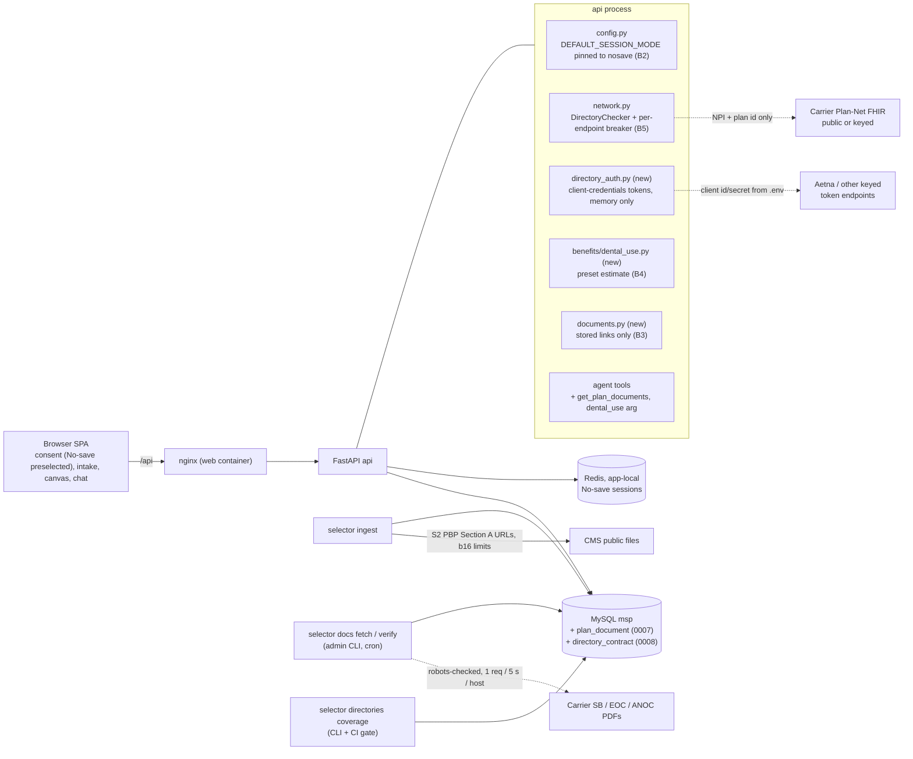

### B1.2 Software layers touched

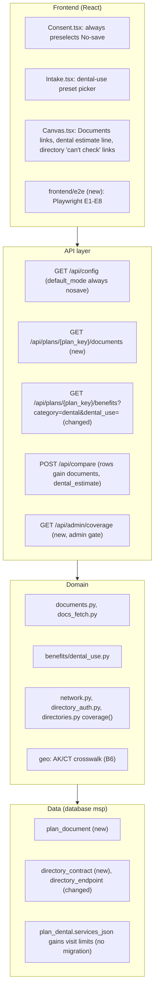

New tables are additive (no column is dropped or retyped), so the Nov 26 – Dec 7 support-window rule "no
schema-breaking changes" still holds if WP14 or WP18 land in that window.

---

## B2. No-save is the default: hard requirement

### B2.1 Requirement

**NS-REQ:** Every new session starts in **No-save** unless the user actively picks Saved on the consent screen. No
configuration value, deployment file or client default may make Saved the preselected or implied mode. Saved mode may
be *offered* (only when `PROFILE_ENC_KEY` is set) but never *defaulted*. This replaces v0.3 §8.1's "No-save unless
Thomas changes it" and OPEN-QUESTIONS Q10's "default, unless Thomas objects": Thomas's 2026-11-21 instruction makes
it fixed.

### B2.2 Verification in the code (`df85aba`, 2026-11-21)

| Place | What it does today | Default is No-save? |
|---|---|---|
| `backend/selector/config.py:71` | `default_session_mode: SessionMode = "nosave"`, `SessionMode = Literal["nosave", "saved"]` | Yes, but **an env value `saved` is accepted** (`tests/unit/test_config.py:27-30` even tests that) |
| `.env.example:30` | `DEFAULT_SESSION_MODE=nosave` | Yes |
| `docker-compose.yml` (dev) | `env_file: .env`; no override | Yes when `.env` comes from `.env.example` |
| `docker-compose.prod.yml` | `env_file: .env` (required); `environment:` does **not** set `DEFAULT_SESSION_MODE` | Only if the server `.env` says so: **not pinned** |
| `deploy/README.md` §1 server `.env` table | Doesn't mention `DEFAULT_SESSION_MODE` | Not stated |
| `GET /api/config` (`routes.py:82`) | Returns `default_mode` from settings | Follows settings |
| `frontend/src/Consent.tsx:14-16` | Preselects `saved` when `config.default_mode === "saved"` and Saved is available, else `nosave` | Follows the API; **honours a Saved default** |
| `frontend/src/App.tsx:138` | `ModeContext` falls back to `"nosave"` | Yes |
| `POST /api/session` (`routes.py:106`) | `mode` is required (no server-side default) | n/a (explicit) |
| `GET /api/session` renewal (`routes.py:167-173`) | An expired No-save cookie renews as No-save | Yes |
| `scripts/smoke.sh:18` | Accepts `default_mode in ("nosave","saved")` | **Doesn't check** |
| Tests | `test_config.py:13` (default), `test_api_nosave.py:115` (`/api/config`), `App.test.tsx:40-41` (radio checked) | Yes, for the default path only |

### B2.3 Gaps (code; fixed in WP16)

| Gap | Where | Fix |
|---|---|---|
| **G1** | `config.py`: `DEFAULT_SESSION_MODE=saved` is accepted | `default_session_mode: Literal["nosave"]`; a `saved` value fails start-up with "DEFAULT_SESSION_MODE must be nosave (DESIGN v0.5 B2)". Replace `test_config.py:27-30` with a rejection test. |
| **G2** | `docker-compose.prod.yml`: not pinned | Add `DEFAULT_SESSION_MODE: nosave` under `x-app.environment` (wins over `env_file`). Same in the dev compose `api` service. |
| **G3** | `Consent.tsx`: honours `default_mode === "saved"` | Always initialise to `"nosave"`; ignore `default_mode` for preselection (keep the field for display). |
| **G4** | `scripts/smoke.sh`: accepts either value | Assert `d["default_mode"]=="nosave"`. |
| **G5** | `deploy/README.md`, `.env.example` comment | State "must be `nosave`; any other value stops the API". |

### B2.4 Default resolution after WP16

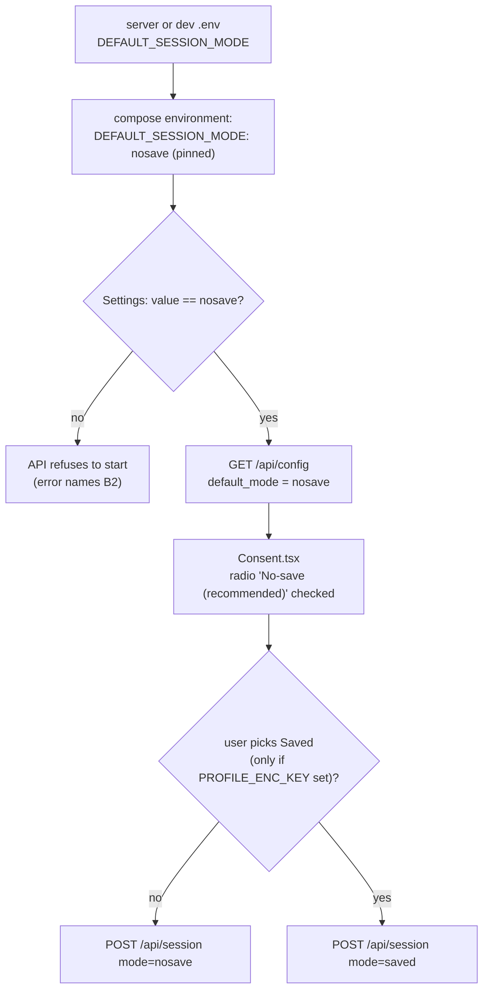

### B2.5 Acceptance tests (WP16)

| ID | Test | File |
|---|---|---|
| NS1 | Settings with no env → `nosave`; `DEFAULT_SESSION_MODE=saved` → validation error naming B2 | `backend/tests/unit/test_config.py` |
| NS2 | `docker compose -f docker-compose.prod.yml config` with a `.env` that sets `saved` still renders `DEFAULT_SESSION_MODE: nosave` | `backend/tests/unit/test_dev_tooling.py` |
| NS3 | Same for the dev compose `api` service | same |
| NS4 | `GET /api/config` → `default_mode == "nosave"` with Saved available (`PROFILE_ENC_KEY` set) | `backend/tests/nosave/test_api_nosave.py` |
| NS5 | Consent: No-save radio checked when config says `default_mode: "saved"` (forged) and when Saved is available | `frontend/src/App.test.tsx` |
| NS6 | Consent: Start without touching the radio sends `mode: "nosave"` | same |
| NS7 | `scripts/smoke.sh` fails when `/api/config` returns `saved` (test drives the script against a stub) | `test_dev_tooling.py` |
| NS8 | Playwright E1 (B7) starts a session without touching the radio and asserts the header shows the No-save line | `frontend/e2e/nosave.spec.ts` |

---
## B3. Carrier documents (WP14)

Replaces the outline in v0.4 A4.5 (whose feasibility notes still hold). Runs after Thomas enrolls (Nov 24, Q17).

### B3.1 Rule: no numbers from carrier documents

Carrier documents are **links only**. No premium, copay, coinsurance, maximum, deductible, star rating or any other
number shown in the table, the ranking, the cost engine or the chat is ever read from a carrier document. CMS public
files (Landscape, PBP, SPUF) stay the **only source of numbers**. The fetcher reads a PDF only to check that it is the
right document (plan ID and plan year on the first pages) and to hash it. The validator keeps rejecting any number not
in a tool row; `get_plan_documents` returns no numbers besides dates and byte counts.

### B3.2 Where the URLs come from (three tiers)

| Tier | Source | Gives | Coverage (Maricopa 2027) | Status |
|---|---|---|---|---|
| **T1** | CMS PBP Benefits 2027, `pbp_Section_A.txt` (S2, same pinned zip as b16): `pbp_a_org_website`, `pbp_a_phys_web_addr` (provider directory), `pbp_a_formulary_web_addr`, `pbp_a_pharmacy_website` | Carrier landing pages per plan segment | 101 of 101 segments have website, formulary and pharmacy URLs; 92 have a provider-directory URL (the 9 without are PDPs, which have no provider network) | **V** (parsed 2026-11-21) |
| **T2** | Curated `sources/carrier_documents.yaml` (new, committed, public URLs only): per carrier, URL templates or lookup pages for SB, EOC, ANOC and formulary PDFs, the robots/terms decision and a spot-check date | Direct PDF links, verified by `docs verify` | Humana EOC pattern (A4.5) **U** until spot-checked; UHC needs a per-plan lookup; Aetna interactive page; others **U** | Curated in WP14 |
| **T3** | Medicare.gov Plan Finder plan page for the plan (deep link built from `plan_year` + `plan_key`) | Official CMS page with the plan's documents section | Every MA and PDP plan | URL pattern **U** (check in WP14; link only, never scraped) |

T1 values are free text typed by carriers ("UHC.com/Medicare", "www.Devoted.com"): the ingest normalises them
(adds `https://` when missing, lower-cases the host, rejects anything that is not `http(s)` or has spaces) and keeps
the raw value in `src_ref`. The UI labels T1 links "Carrier website (from CMS plan data)".

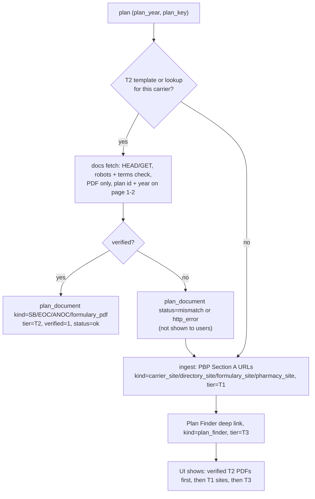

### B3.3 Data model (Alembic `0007`, database `msp`)

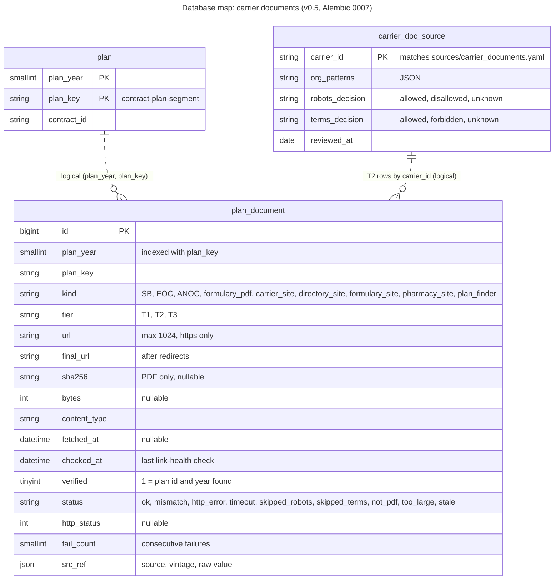

- Unique key `(plan_year, plan_key, kind, tier)`; index `(status, checked_at)` for the health job.
- Plan data, no user link: written by the ingest role (`msp_ingest`), read-only for `msp_api`, like `plan_dental`.
- T1 rows are rebuilt by every ingest in the same transaction as the other S2 tables; T2/T3 rows survive an ingest
  (they are keyed by plan and only marked `stale` if the plan disappears from the plan year).
- Fetched PDFs are kept under the git-ignored `data/docs/<plan_year>/<sha256>.pdf` for re-verification only, **never
  committed** (the forbidden-files hook blocks `data/`), deleted after 60 days.
- `carrier_doc_source` is seeded from `sources/carrier_documents.yaml` by `docs fetch` (like `directory_endpoint`).

### B3.4 CLI: `selector docs`

| Command | What it does |
|---|---|
| `selector docs fetch --year 2027 [--carrier X] [--limit N] [--dry-run]` | For plans whose T2 row is missing or older than 30 days: robots.txt check (cached 24 h), terms decision from the YAML (`forbidden` → `skipped_terms`, no request), HEAD then GET (≤ 15 MB, `application/pdf` only), `pdftotext` pages 1–2, verify plan id (`H1234-567` or `H1234_567`) and plan year appear, sha256, upsert. 1 request / 5 s per host, User-Agent `medicare-plan-selector/<version> (+https://github.com/thomas-choi/medicare-plan-selector)`. |
| `selector docs verify --year 2027 [--kind ...] [--max-age 7d]` | Link health for every stored row (T1, T2 and T3): HEAD (GET with `Range: bytes=0-0` when HEAD isn't allowed), follow ≤ 5 redirects, record `http_status`, `final_url`, `checked_at`; 2xx = ok; 404/410 = `http_error`; timeouts/5xx increment `fail_count`; a row with `fail_count ≥ 3` is hidden from users until it passes again. For T2 PDFs, a changed `Content-Length` or `ETag` triggers a re-fetch and re-verify. |
| `selector docs report --year 2027 [--county 03060]` | Counts by kind/tier/status per carrier; exits non-zero when any plan in the county has **no** shown link at all (T3 always exists, so this catches a broken T3 pattern). |

Run by cron on the server (weekly `verify`, monthly `fetch`), never in a user's request path. Make targets
`docs-fetch`, `docs-verify`, `docs-report` (documented in `docs/OPERATION.md`, rule R-A).

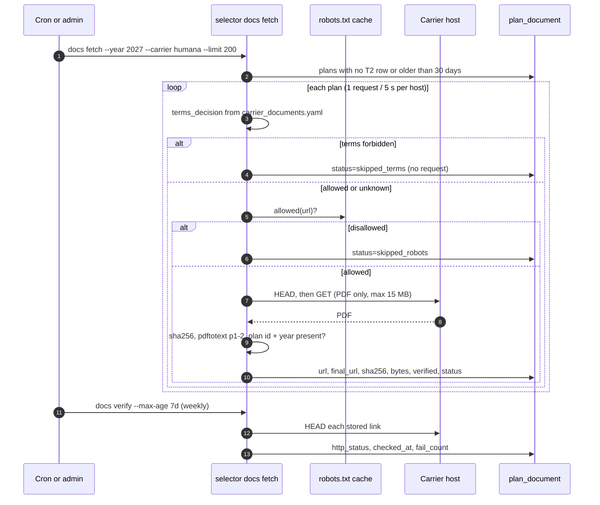

### B3.5 API

New `GET /api/plans/{plan_key}/documents` (full entry in B11). `POST /api/compare` rows get
`documents: [{kind, tier, url, verified, checked_at, label}]` (only rows that are shown: `status=ok` and
`fail_count < 3`), as v0.4 A6 already promised. `GET /api/plans/{plan_key}/benefits` is unchanged (it stays about
CMS numbers).

### B3.6 UI

- **Table (Canvas):** a small "Documents" link per row opening a popover with the shown links, best first:
  "Summary of Benefits (carrier PDF, checked Nov 28)", "Evidence of Coverage (carrier PDF)", "Carrier website (from
  CMS plan data)", "Provider directory (carrier site)", "Drug list (carrier site)", "Medicare.gov Plan Finder".
- **Side-by-side:** a "Plan documents" section per column with the same list; the baseline column links the chosen
  PDP's documents and Medicare.gov's Original Medicare pages.
- Every link opens in a new tab with `rel="noopener noreferrer"`; the referrer policy stays `no-referrer`, so carriers
  never learn the session. A one-line note: "Carrier documents are for reading. Numbers in this tool come from CMS
  data; if a document differs, check with the plan."
- Export (`exportMd.ts`) lists the links under each plan.

### B3.7 Agent tool

`get_plan_documents(plan_key) → {plan_key, plan_year, documents: [{kind, tier, url, verified, checked_at}], src_ref}`.
Prompt rule: the model may point to a document ("the plan's Evidence of Coverage explains the referral rules") but must
not quote any number from it; the validator already rejects numbers absent from tool rows.

### B3.8 Tests (WP14)

| ID | Test |
|---|---|
| CD1 | robots.txt disallow → `skipped_robots`, no GET |
| CD2 | Rate limit: ≥ 5 s between requests to one host (fake clock) |
| CD3 | Non-PDF or > 15 MB → rejected; PDF without the plan id/year → `verified=0`, not shown |
| CD4 | Forbidden-files hook blocks a fetched PDF under `data/` from being committed |
| CD5 | Ingest on the Section A fixture: T1 rows for every fixture plan; `UHC.com/Medicare` → `https://uhc.com/Medicare`; a value with spaces or `javascript:` is rejected |
| CD6 | Terms `forbidden` → `skipped_terms`, zero HTTP calls (respx) |
| CD7 | `docs verify`: 404 → `http_error`; three timeouts → hidden; a later 200 → shown again |
| CD8 | `GET /api/plans/{plan_key}/documents` and compare rows: only shown rows, ordered T2 verified → T1 → T3; `404 unknown_plan` |
| CD9 | No numbers: `get_plan_documents` output contains no `$`/`%` values; the validator rejects a chat sentence quoting a number "from the EOC" |
| CD10 | UI: Documents popover and side-by-side section render, links have `rel="noopener noreferrer"`; export lists them |
| CD11 | `docs report --county 03060` (Maricopa SSA code) exits 0 on the fixture and 1 when a plan has no shown link |

---
## B4. Dental-use preset (OD-16, WP17)

Replaces the one-line preset in v0.4 A4.4 (`none | cleanings | major`). Q16 stands: dental is **never** added to the
yearly total and never changes the ranking.

### B4.1 Presets (per year, the user picks one; default `none`)

| Preset | UI label | Assumed services per year | PBP b16 service codes |
|---|---|---|---|
| `none` | "I don't plan dental work" | nothing (default) | – |
| `preventive` | "Check-ups and cleanings only" | 2 oral exams, 2 cleanings, 1 set of X-rays | `oe` ×2, `pc` ×2, `dx` ×1 |
| `basic` | "Check-ups plus a couple of fillings" | preventive + 2 fillings + 1 simple extraction | + `rs` ×2 (filling), `omsg` ×1 |
| `major` | "Major work: a crown and a root canal" | preventive + 1 root canal + 1 crown | + `end` ×1, `rs` ×1 (crown) |
| `dentures` | "Dentures" | preventive + 1 full set of removable dentures | + `prm` ×1 |

`cleanings` (the v0.4 name) is accepted as an alias of `preventive` for one release.

### B4.2 Inputs from CMS PBP b16 (S2)

Already parsed (WP12): per service `copay_min/max_cents`, `coins_min/max_pct`, `mandatory`/`optional`; preventive and
comprehensive maximums with periodicity and the shared flag. **Added in WP17** (no migration; new keys in
`plan_dental.services_json`, filled by a re-ingest):

| Field (b16 dictionary, **V** 2026-11-21) | Meaning | New key |
|---|---|---|
| `pbp_b16{b,c}_bendesc_<svc>_lim` | "Is this benefit unlimited?" 1 = yes, 2 = no | `unlimited: bool` |
| `pbp_b16{b,c}_bendesc_<svc>_num` | Number of visits | `visits: int \| null` |
| `pbp_b16{b,c}_bendesc_<svc>_per` | Periodicity (1 = 3 years … 7 = month, same codes as the maximums) | `visits_period` |
| `pbp_b16{b,c}_auth_<svc>_yn`, `_refer_<svc>_yn` | Prior authorization / referral required | `auth: bool`, `referral: bool` |

The 2027 header has the `_lim/_num` pair for every preventive and comprehensive service code. When `_lim` = 2 and
`_num` is blank, the CMS free text (`limit_text`) is shown and the visit cap is treated as unknown.

### B4.3 Assumed prices

There is no CMS price data for dental work. Each service needs an assumed **allowed amount** per visit, stored in
`sources/2027.yaml` under `dental_use_assumptions` with a citation and status **U**:

```yaml
dental_use_assumptions:          # status U; never used for ranking or the yearly total
  region: "Phoenix-Mesa-Chandler, AZ"
  source: S26                    # chosen and cited in WP17, approved by Thomas (Q22)
  services_cents: {oe: null, pc: null, dx: null, rs_filling: null, rs_crown: null, omsg: null, end: null, prm: null}
```

Until every amount has a cited source that Thomas has approved (Q22), the preset runs in **coverage-only mode**:
covered visits, cost-sharing text and the maximum are shown, with no dollar estimate. Candidate public sources (to
check in WP17): FAIR Health Consumer cost lookup (https://www.fairhealthconsumer.org/dental) by ZIP 850xx, and the ADA
Health Policy Institute fee survey (paid, likely not usable). The user may also type their dentist's quote for any
service, which wins over the assumption and is labelled "your quote".

### B4.4 Calculation (per plan, per preset)

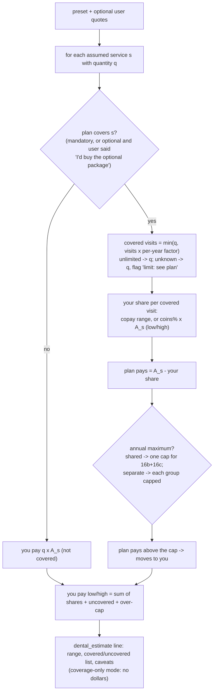

Rules:
- Periods: `PER_YEAR` from `pbp_dental.py` (3 years → ⅓ visit/yr, 6 months → 2/yr, …); fractional caps round down,
  at least 0.
- Copay *and* coinsurance on one service: both apply (copay + coins% × (A − copay)), low = mins, high = maxes.
- Medicare-covered dental (16a) is not part of any preset.
- PDPs and the baseline row: "No routine dental: you'd pay the full cost" with the preset's total at assumed prices
  (coverage-only mode: "not covered").
- Optional supplemental packages (`*_amo` = 3) are excluded unless the user ticks the box; their premium is unknown
  in CMS data, so the line says "plus the optional package's premium (ask the plan)".
- Network: the estimate assumes an in-network dentist; out-of-network cost sharing is not modelled (caveat).

Caveats shown with every estimate (exact text, fixed in WP17 tests): "Estimate only. Dental prices are assumptions
(see source), not CMS data. Plans may have waiting periods, network rules, prior authorization and frequency limits
beyond what CMS lists. Check with the plan and your dentist."

### B4.5 UI, API and tool

- **Intake:** a "Dental plans for next year" select with the five presets and an optional "my dentist's quotes"
  disclosure (per service, dollars). Stored in the profile like other intake fields (No-save: Redis only).
- **Table:** under the Dental cell, "Dental estimate: $180–$420/yr (basic)"; coverage-only mode shows "Covers 2 of 2
  cleanings, fillings 20–50%". Never in "Estimated yearly cost", never in the sort or rank.
- **Side-by-side:** a breakdown per service (covered visits, your share, plan pays, cap applied) with `src_ref`
  (S2 b16 + S26 assumptions).
- **API:** `POST /api/compare` `profile.dental_use` gains `preventive | basic | major | dentures`;
  `profile.dental_quotes_cents?: {service: int}`; `profile.dental_optional?: bool`; rows gain `dental_estimate`.
  `GET /api/plans/{plan_key}/benefits?category=dental&dental_use=basic` adds `dental_estimate` (B11).
- **Tool:** `get_plan_benefits(plan_key, category='dental', dental_use?)` returns the same `dental_estimate`; the
  validator treats its dollar amounts as tool numbers. Prompts must call it an estimate and cite the assumption source.

### B4.6 Tests (WP17)

| ID | Test |
|---|---|
| DU1 | Parser: `_lim/_num/_per/_auth/_refer` on the b16 fixture → `unlimited`, `visits`, `visits_period`, `auth`, `referral` |
| DU2 | Golden H0028_028_0, `preventive`, fixture assumptions: covered visits, your share, $500 shared maximum respected |
| DU3 | Cap: `major` on a plan with a $1,000 shared maximum moves the excess to "you pay"; separate maxima cap each group |
| DU4 | Visit limit: 2 cleanings on a plan with 1 cleaning / 6 months → both covered; with 1 / year → 1 covered, 1 at full price |
| DU5 | Optional supplemental excluded by default; included with `dental_optional=true` and the premium caveat |
| DU6 | Coverage-only mode when any needed assumption is `null`: no dollar amounts anywhere (API, UI, tool) |
| DU7 | Ranking and yearly totals identical for every preset (golden Maricopa JSON) |
| DU8 | User quote wins over the assumption and is labelled "your quote" |
| DU9 | PDP and baseline rows: "No routine dental" with the preset at assumed prices (or "not covered" in coverage-only mode) |
| DU10 | `cleanings` alias accepted; unknown preset → `422 invalid` |
| DU11 | UI: preset select, estimate line, side-by-side breakdown and caveat text (Vitest) |
| DU12 | Validator rejects a dental estimate amount not present in a tool row |

---
## B5. Doctor directories for every Maricopa carrier, Aetna included (WP18)

Extends v0.4 A3 (WP13, implemented for UHC and Humana). Thomas: "add doctor directory including Aetna, all carriers in
Maricopa must in".

### B5.1 Who offers plans in Maricopa County, AZ for 2027

Source: CMS **CY2027 Landscape** `CY2027_Landscape_202611.csv` (S1, zip sha256 `0b479aa3…210f62f`, the same file pinned
in `sources.lock`), rows with state AZ and county "Maricopa" (MA, MA-PD, SNP) or "All Counties" (PDP). Parsed
2026-11-21 (**V**): **16 parent organizations, 101 plan segments (92 MA/MA-PD/SNP in 31 contracts, 9 PDP in 5
contracts)**. The committed dev fixture (`backend/tests/fixtures/cms/2027/landscape.csv`) is a sample and was not used
for this list. Provider directories matter for the MA contracts; PDPs have no provider network, so the coverage rule
(B5.6) covers H/R contracts only.

### B5.2 Carrier-by-carrier directory status (checked 2026-11-21)

"Checked" means we called the URL from the box on 2026-11-21 between 00:45 and 01:00 MST with a project User-Agent and
no credentials: `GET /metadata` and one small search. Statuses: **live** (public, answered with data), **needs key**
(registration / client credentials required), **broken** (documented as public but failing), **not found** (no public
Provider Directory API located).

| # | Parent org (marketing name) | Maricopa contracts (MA segs) | PDP | Provider Directory API base URL | Key needed? | Status 2026-11-21 | Evidence |
|---|---|---|---|---|---|---|---|
| 1 | Humana Inc. (Humana) | H0028, H4461, H5216, H7617, R7220 (15) | S5884 | `https://fhir.humana.com/api` | No | **live** (in `directories.yaml`) | `/metadata` 200; `InsurancePlan?_count=1` 200 (**V**); S13 |
| 2 | Devoted Health (Devoted Health) | H6586, H7993, H8173 (16) | – | `https://fhir.devoted.com/fhir` | No | **live** | `/metadata` 200; `InsurancePlan?_count=1` 200 (**V**); S18 |
| 3 | UnitedHealth Group (UnitedHealthcare / AARP) | H0321, H0609, H0710 (9) | S5921 | `https://flex.optum.com/fhirpublic/R4` | No | **live** (in `directories.yaml`) | `/metadata` 200; `InsurancePlan` total 1,395 (**V**). H0321 is UHC Community Plan (D-SNP): mapping **U** |
| 4 | SCAN Group (SCAN Desert Health Plan) | H1822 (8) | – | none found | ? | **not found** | Only a web search and a payer-to-payer portal (S19); **U** |
| 5 | CVS Health (Aetna Medicare) | H4835, H5521, H8332 (6) | S5601 | `https://apif1.aetna.com/fhir/v1/providerdirectory` | **Yes**: client id + secret (OAuth2 client credentials, token URL `https://apif1.aetna.com/fhir/v1/fhirserver_auth/oauth2/token` from the CapabilityStatement) | **needs key** | `/metadata` 200 (public); `Practitioner?_count=1` and `InsurancePlan?_count=1` → **401 "Invalid client id or secret."** (**V**); S13 Aetna portal |
| 6 | Health Care Service Corp. (HealthSpring) | H0354, H7849 (5) | S5715 | not published; developer portal `https://interoperability.healthspring.com/` | **Yes** (portal: sandbox sign-up, "apply for production credentials … several weeks") | **needs key** | Portal page read (**V**); base URL **U**; S20 |
| 7 | Centene (Wellcare) | H0351, H5590 (3) | S4802 | `https://iopc-pd.api.centene.com/iopc/pd/fhir/providerdirectory` | No | **live** | `/metadata` 200 (HAPI); `Practitioner?family=SMITH` 200 (**V**); InsurancePlan → plan id mapping **U**; S21 |
| 8 | Elevance Health (Wellpoint) | H1423, H2593 (5) | – | `https://totalview.healthos.elevancehealth.com/resources/unregistered/api/v1/fhir/cms_mandate/mcd` (path documented for Medicaid; Medicare brand path **U**) | **Yes** (registration form, client credentials by secure email) | **needs key** | `/metadata` 200; data calls 500 without a token (**V**); S22 |
| 9 | Alignment Healthcare (Alignment Health Plan) | H3443 (5) | – | not published; ADAS developer portal `https://adas.alignmenthealth.com/` (API key + OAuth2 client credentials) | Likely yes | **needs key** (**U**) | Portal home read via search (**D**); S23 |
| 10 | Blue Cross Blue Shield of Arizona (AZ Blue, Health Choice) | H0302, H5587 (4) | – | `https://azblue.innovaccer.com/fhir/` (published as "base URL for our APIs") | Yes (token) | **needs key** | `Practitioner?_count=1` → 401 "Service/user token not provided" (**V**); azblue.com/interoperability read (**V**) |
| 11 | Gold Kidney Health Plan | H4869 (4) | – | `https://api.aaneelconnect.com/cms/r4/providerdirectory` + `CHCPAYERID=19cd758ff6e34341967364121178e204` | No (documented) | **broken** | `/metadata` 404; `Practitioner`/`InsurancePlan` 500 (**V**); AaNeel Connect docs (**D**) |
| 12 | Eternal Health (eternalHealth) | H3551 (3) | – | none; site says the directory is "publicly available on our website" (PDFs) | – | **not found** | eternalhealth.com/interoperability read (**V**) |
| 13 | Banner Health (Banner Medicare Advantage) | H4931, H5843 (3) | – | not published; Banner names Innovaccer as its API vendor | ? | **not found** (**U**) | bannerhealth.com returned 403 to our fetch; search extract (**D**) |
| 14 | Mercy Care (Mercy Care Advantage) | H5580 (3) | – | not published; Mercy Care AZ is administered by Aetna and posts machine-readable JSON (MCA-Index) | ? | **not found** (**U**); likely Aetna's platform | mercycareaz.org provider directory page (search extract, **D**). Note: `mercycarefhir.healthsparq.com` is MercyCare Health Plans (Wisconsin), a **different** company; don't use it |
| 15 | Verda Healthcare (Verda Health Plan of Arizona) | H2630 (2) | – | none found | ? | **not found** | Provider manual and PDF directory only (search, **D**) |
| 16 | Molina Healthcare (Molina Healthcare of Arizona) | H8845 (1) | – | `https://api.interop.molinahealthcare.com/providerdirectory` | No | **live** | `/metadata` 200; `Practitioner?family=Smith&_count=1` 200, total 3,151 (**V**); needs ≥ 1 search parameter |

Summary by MA plan segments (92): **live 44** (Humana 15, Devoted 16, UHC 9, Wellcare 3, Molina 1); **needs key 25**
(Aetna 6, HealthSpring 5, Wellpoint 5, Alignment 5, AZ Blue 4); **broken or not found 23** (SCAN 8, Gold Kidney 4,
eternalHealth 3, Banner 3, Mercy Care 3, Verda 2).

Context (S13, S24): CMS-9115-F requires each MA organization to run a public Provider Directory API (42 CFR
422.120). On 2026-06-24 CMS told MA organizations to report, per contract, a "FHIR Provider Directory API Endpoint" in
HPMS by 2026-07-10 and said "CMS must be able to access your API endpoint(s) without a client registration
requirement." So the "not found" and "needs key" carriers have reported *something* to CMS; HPMS is not public to us.
The same memo collects an MPF provider-directory index URL per contract, which feeds Medicare.gov Plan Finder's doctor
search; that is why the fallback (B5.5) links to Plan Finder.

### B5.3 Needed `sources/directories.yaml` entries (design spec; the code YAML is edited in WP18, not here)

Each Maricopa carrier gets an entry, including carriers with no usable API, so the coverage check can tell "known and
not checkable" from "missing". New fields: `status`, `parent_orgs` (Landscape "Parent Organization Name", exact),
`contract_ids` (explicit list for the plan year, replacing pattern-only matching), `key_env_prefix`,
`token_url`, `fallback_url_source`.

```yaml
# Spec only (WP18 writes the real file). Public URLs only; never keys.
endpoints:
  - id: devoted
    name: Devoted Health
    parent_orgs: ["Devoted Health, Inc."]
    contract_ids: {2027: [H6586, H7993, H8173]}
    base_url: https://fhir.devoted.com/fhir
    auth: none
    status: live
    npi_search: unverified          # WP18 checks Practitioner?identifier=
  - id: centene
    name: Wellcare (Centene)
    parent_orgs: ["Centene Corporation"]
    contract_ids: {2027: [H0351, H5590]}
    base_url: https://iopc-pd.api.centene.com/iopc/pd/fhir/providerdirectory
    auth: none
    status: live
  - id: molina
    name: Molina Healthcare
    parent_orgs: ["Molina Healthcare, Inc."]
    contract_ids: {2027: [H8845]}
    base_url: https://api.interop.molinahealthcare.com/providerdirectory
    auth: none
    status: live
  - id: aetna
    name: Aetna (CVS Health)
    parent_orgs: ["CVS Health Corporation"]
    contract_ids: {2027: [H4835, H5521, H8332]}
    base_url: https://apif1.aetna.com/fhir/v1/providerdirectory
    auth: client_credentials
    token_url: https://apif1.aetna.com/fhir/v1/fhirserver_auth/oauth2/token
    key_env_prefix: DIRECTORY_AETNA     # reads DIRECTORY_AETNA_CLIENT_ID / _CLIENT_SECRET from .env
    status: needs_key
  - id: healthspring   # auth: client_credentials, status: needs_key, base_url: "" until the portal gives one
  - id: wellpoint      # auth: client_credentials, status: needs_key, Medicare path to confirm
  - id: alignment      # auth: client_credentials, status: needs_key (U)
  - id: azblue         # auth: client_credentials, status: needs_key
  - id: goldkidney     # auth: none, status: broken, base_url + query_params: {CHCPAYERID: 19cd758ff6e34341967364121178e204}
  - id: scan           # auth: none, status: not_found, base_url: ""
  - id: eternal        # status: not_found
  - id: banner         # status: not_found
  - id: mercycare      # status: not_found (check whether Aetna's endpoint covers H5580)
  - id: verda          # status: not_found
  # humana and uhc: add parent_orgs, contract_ids and status: live to the existing entries
```

`auth` values become `none | client_credentials | app_key | unsupported`; `status` values `live | needs_key | broken |
not_found`. `fallback_url_source: pbp_section_a` (default) means the "can't check" message links the plan's
`pbp_a_phys_web_addr` (B3, T1).

### B5.4 Data model change (Alembic `0008`, database `msp`)

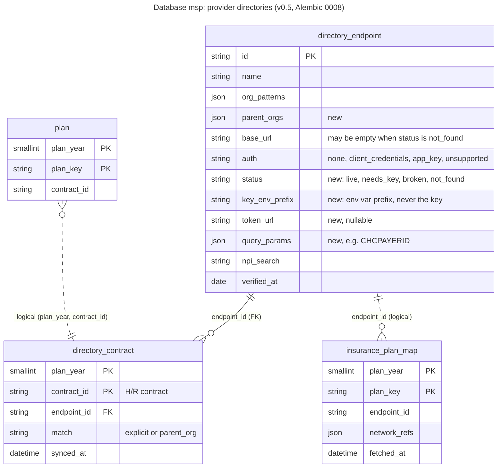

`directory_contract` is built by `selector directories sync` from `contract_ids` (explicit) and, for contracts not
listed, from the Landscape parent organization (`match = parent_org`). It is plan data (no user link).

### B5.5 Aetna (and other keyed carriers): registration and key handling

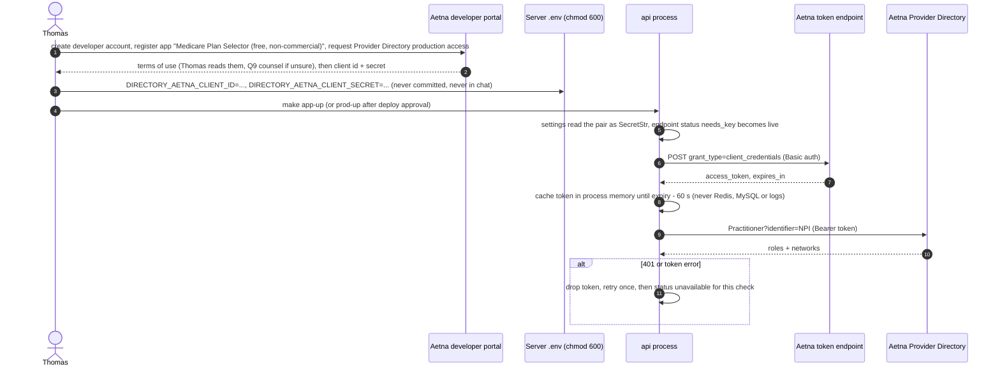

Rules:
- Secrets only in `.env` (server and coding host), never in git, chat, hub messages, logs or `/api/config`.
  `.env.example` gets blank placeholders `DIRECTORY_AETNA_CLIENT_ID=` / `DIRECTORY_AETNA_CLIENT_SECRET=`.
  gitleaks and the forbidden-files hook stay on.
- The generic pattern `DIRECTORY_<ID>_CLIENT_ID/_CLIENT_SECRET` serves every `client_credentials` endpoint
  (HealthSpring, Wellpoint, Alignment, AZ Blue) once Thomas registers there.
- A missing key keeps today's behaviour: `unavailable`, "This plan's directory can't be checked automatically. Call the
  plan." plus the fallback links. The coverage check counts it as covered-but-not-checkable.
- What is sent: NPI and plan ids only (unchanged, P10). The token request carries only the app's credentials.
- Registration is Thomas's personal decision (his account, his acceptance of the carrier's terms): **Q14 needs him**.
  Alternative without registration: ask Aetna for unauthenticated access, citing CMS's 2026-06-24 memo; drafting that
  message is a separate, approval-gated step.

### B5.6 Fallback when a directory is down, and the coverage check

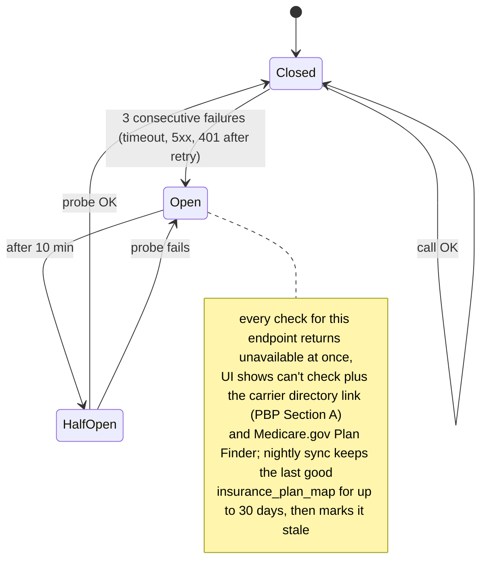

- The breaker lives in process memory per endpoint (no new store). Directory problems never affect `/api/ready`: the
  app stays up and says "can't check".
- **Coverage check:** `selector directories coverage --year 2027 --county 03060 [--strict]`:
  1. lists every H/R contract offered in the county (Landscape → `plan_county` + `plan`);
  2. resolves each to a `directory_contract` row;
  3. **fails (exit 1)** when any contract has no row, naming the contract and parent organization ("carrier missing
     from sources/directories.yaml");
  4. prints the status mix (live / needs_key / broken / not_found) and the share of MA plans checkable;
  5. with `--strict`, also probes each `live` endpoint's `/metadata` and fails if one doesn't answer.
  It runs at the end of `selector ingest` (warning) and `selector directories sync` (error), in CI against the
  fixture, and its result is shown on `GET /api/admin/coverage` (admin gate). A new carrier in next year's Landscape
  therefore fails the sync until someone adds it to the YAML.

### B5.7 Tests (WP18)

| ID | Test |
|---|---|
| DIR1 | `directories.yaml` loads every Maricopa 2027 parent org in the B5.2 table; `status`/`auth` enums validated |
| DIR2 | Coverage check on a fixture county: all contracts mapped → exit 0; remove one carrier → exit 1 naming it |
| DIR3 | `--strict` with a recorded failing `/metadata` → exit 1; without `--strict` → 0 with a warning |
| DIR4 | Client credentials: token fetched once, reused until expiry − 60 s, refreshed after; 401 → one retry then `unavailable` |
| DIR5 | Missing `DIRECTORY_AETNA_*` → Aetna plans `unavailable`, no HTTP call to Aetna (respx) |
| DIR6 | Secrets never appear in logs, `/api/config`, exceptions or the admin coverage output (sentinel secret grep) |
| DIR7 | Breaker: 3 failures open it, checks return `unavailable` without calls, half-open probe closes it |
| DIR8 | Sync failure keeps the previous `insurance_plan_map`; older than 30 days → `stale` and checks say "can't check" |
| DIR9 | Recorded bundles for Devoted, Centene and Molina map `InsurancePlan` → plan_key for the fixture plans (or record `npi_search: unverified` and `unknown`, never `not_listed`) |
| DIR10 | UI: "can't check" badge links the carrier directory (T1) and Plan Finder |
| DIR11 | Outbound requests still carry only NPI and plan ids (P10 extended to the new endpoints and the token call) |

---
## B6. Alaska and Connecticut county mapping (WP19)

`sources/2027.yaml` `pending_fips_states: [Alaska, Connecticut]` (approved 2026-11-12, "fix before public launch").
Today those counties load with `fips_status='pending'`, so a ZIP in AK or CT can't be resolved to an SSA county.

Findings (2026-11-21):
- The CMS MA State/County Penetration file for November 2026 (XW1, the crosswalk's primary source) has **no rows at all**
  for Alaska or Connecticut (**V**: parsed `State_County_Penetration_MA_2026_11.csv`, 53 states/territories, none of
  them AK or CT). That is why they are pending.
- **Connecticut:** Census replaced the 8 counties with 9 planning regions (FIPS 09110–09190) in 2022 (Federal Register
  2022-12063, S27), but CMS rate books and SSA county codes still use the 8 legacy counties; CMS plans to switch to the
  planning regions from CY2028 (S27, **D**). Census 2020 `national_county2020.txt` (already a source) still lists the
  legacy FIPS 09001–09015 (**V**). HUD ZIP→county files may return planning-region codes (**U**, check in WP19).
- **Alaska:** SSA codes are by borough/census area; the 2019 split of Valdez-Cordova (02261) into Chugach (02063) and
  Copper River (02066) is the known mismatch (Census list **V**; the SSA side **U**).

Design:
1. Add the NBER "SSA to FIPS State and County Crosswalk" for the plan year (S27,
   https://www.nber.org/research/data/ssa-federal-information-processing-series-fips-state-and-county-crosswalk, built
   from CMS files) as a secondary crosswalk source `XW2`, pinned by sha256 in `sources.lock` like the others; used only
   for SSA codes missing from XW1.
2. Connecticut: map the 8 legacy SSA counties to legacy FIPS 09001–09015 (one-to-one). For ZIPs whose HUD row gives a
   planning region, map the region to its legacy county(ies) with the Census CT county-to-planning-region relationship
   file (S27); when one region spans two legacy counties, show the existing county picker. Rows go in
   `sources/ssa_fips_overrides.csv` with citations.
3. Alaska: map every borough/census area; for 02063/02066 map to the SSA code CMS uses (one or two rows, cited).
4. Remove `pending_fips_states` once validation shows every AK and CT SSA code in the Landscape maps to a FIPS; the
   ingest validation keeps failing if any state other than the listed ones has a pending county.

Tests: **AK1** every AK/CT Landscape county gets a FIPS on the fixture; **AK2** a CT ZIP whose HUD row is a planning
region resolves to the right legacy county or offers the picker; **AK3** Chugach/Copper River ZIPs resolve; **AK4**
`pending_fips_states` empty and validation passes; ingest fails if a new pending county appears.

---

## B7. Playwright end-to-end tests and the browser half of N9 (WP20)

The v0.3 plan promised Playwright for M4 (Nov 16) and N9; neither exists (no `@playwright/test` in
`frontend/package.json`, no e2e folder; checked at `df85aba`).

- **Where:** `frontend/e2e/*.spec.ts`, `frontend/playwright.config.ts`; `@playwright/test` as a dev dependency via
  `npm` with the lockfile (S28); Chromium only; `npx playwright install chromium` on the coding host (an install step
  the worker asks about first, per CLAUDE-HANDOFF).
- **Target:** the dev compose app (`make app-up` after `make ingest-dev`, `LLM_PROVIDER=fake`, no keys), base URL
  `http://127.0.0.1:8080`. RxNav and NPPES are mocked with `page.route` so the run is offline and deterministic.
- **Make target:** `make e2e` (starts the stack if needed, runs Playwright, keeps the HTML report under the git-ignored
  `frontend/playwright-report/`). CI: optional job, required before the public launch.
- **DB assertions** (N9b) go through a small read-only helper `scripts/e2e_db_check.py` using the local test MySQL
  (never `192.168.0.216`, rule A10.3).

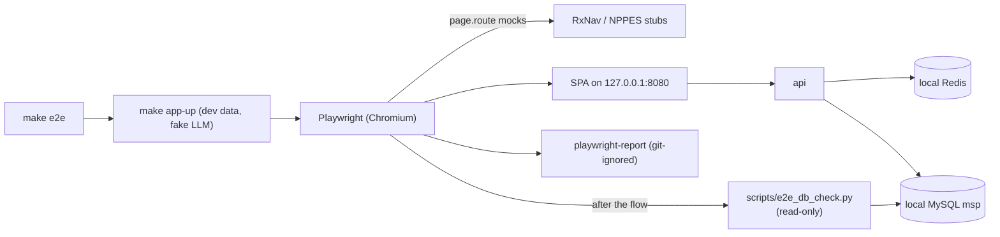

| ID | Test |
|---|---|
| E1 | Happy path: consent (No-save preselected, not touched) → ZIP 85004 → RxCUI 197361 → Compare → top rows + baseline row → Side-by-side → Checklist → Download comparison → End session & erase (also NS8) |
| E2 | No-LLM path (`LLM_PROVIDER` blank): form → table → checklist, no chat box |
| E3 | **N9a:** after intake and compare, `localStorage` and `sessionStorage` are empty, `indexedDB.databases()` is empty, no Cache Storage entries; the only cookie is the httpOnly session cookie on `/api` |
| E4 | **N9b:** sending a team message shows the storage notice; `e2e_db_check.py` finds exactly one new `feedback` row with `session_id IS NULL AND mode='nosave'` |
| E5 | End session & erase → cookie cleared; reload shows the consent screen; `GET /api/session` returns no session |
| E6 | Saved mode (with a test `PROFILE_ENC_KEY`): Delete my data → no rows remain (`e2e_db_check.py`) |
| E7 | Drug search states with stubs: full string → fallback list with 863669 first; nothing → "No drugs found"; 503 → RxCUI hint |
| E8 | Split-county ZIP 85142 shows the county picker |

---

## B8. Cloud deploy checklist: med.thomas-choi.com (WP21, approval-gated)

Nothing here runs without **Thomas's explicit OK in chat**: first to merge and push `main` (Q12), then to deploy.
Owner: Thomas (approvals, server access, secrets); Philip prepares and reviews; the Claude worker never deploys.
Operator detail stays in `deploy/README.md` and `docs/OPERATION.md` (rule R-A).

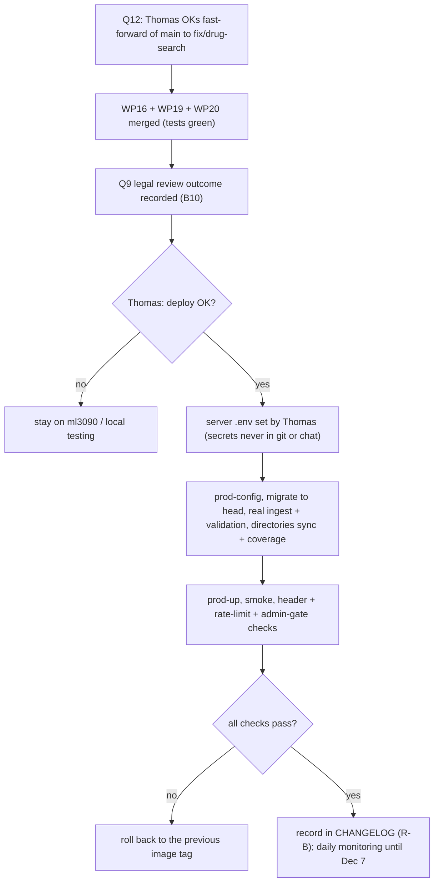

| # | Check | How / acceptance |
|---|---|---|
| D1 | Approvals recorded | Thomas's chat OK for the merge/push (Q12) and, separately, for the deploy; quoted in the CHANGELOG entry |
| D2 | Port and TLS (Q5) | `MED_PUBLIC_PORT` chosen; certificate via HTTP-01 (port 80) or DNS-01/wildcard; TLS A-grade headers (HSTS, CSP `default-src 'self'`, `nosniff`, `Referrer-Policy: no-referrer`) |
| D3 | Server `.env` | From `.env.example`; long random `MYSQL_ROOT_PASSWORD`, `REDIS_PASSWORD`, role passwords, `ADMIN_GATE_SECRET`; `COOKIE_SECURE=true`; LLM provider/model/key and `LLM_PRICE_*`; `DEFAULT_SESSION_MODE=nosave` (pinned anyway, B2); `PROFILE_ENC_KEY` only if Saved mode should be offered at launch (Thomas decides); `chmod 600`; never committed |
| D4 | Data | `make prod-config`; migrations to head (`0006`, plus `0007`/`0008` if WP14/WP18 are in); real 2027 ingest passes validation incl. the golden row; `directories sync` + `directories coverage` run |
| D5 | Smoke | `make smoke SMOKE_URL=https://med.thomas-choi.com:<port>` passes; `/api/config` says `default_mode: nosave` |
| D6 | Abuse controls | nginx rate limits verified with a load script; `MAX_SESSIONS_PER_IP_PER_DAY=5`; `LLM_DAILY_BUDGET_USD` set and the cap triggers no-LLM mode in a test |
| D7 | Admin | `/admin` blocked from non-allowlisted IPs; basic auth works |
| D8 | Privacy | N6 on the server Redis (`CONFIG GET save` empty, `appendonly no`); logs contain no sentinels after a smoke run |
| D9 | Backups and rollback | Nightly encrypted `mysqldump` of non-plan tables; previous image tag kept; rollback steps rehearsed once |
| D10 | Monitoring | Daily error rate and LLM spend check until Dec 7 (who: Thomas or Philip) |

---

## B9. ml3090 drug-search checks from v0.4 A2.3 (WP22)

These four checks can only run on ml3090 and have **no recorded result**. Owner: Thomas runs them (or approves Philip
running them over the agreed route); Philip records the output in `qa/ML3090-A2.3.md` and a CHANGELOG entry (R-B).

| # | Check (A2.3) | Command on ml3090 | Pass | Result |
|---|---|---|---|---|
| M1 | api container reaches RxNav | `docker compose exec api python -c "import httpx;print(httpx.get('https://rxnav.nlm.nih.gov/REST/version.json',timeout=5).status_code)"` | `200` | not run |
| M2 | container DNS | `docker compose exec api getent hosts rxnav.nlm.nih.gov` | an address | not run |
| M3 | lookups not off | `make app-logs` while searching | no `503 lookup_unavailable` | not run |
| M4 | new bundle | hard-refresh after `make app-up`; search "tamsulosin 0.4 mg capsule" | fallback list, 863669 first | not run |

If M1/M2 fail: host firewall or proxy (`HTTPS_PROXY` for the api service) or Docker DNS (`/etc/docker/daemon.json`).

---

## B10. Legal review before the Nov 25 public launch (Q9, WP23)

DESIGN §8.4 is our reading and unverified. Owner: **Thomas** (chooses and engages counsel, decides go/no-go); Philip
prepares the packet. Deadline: outcome by **Mon Nov 24, 5 PM MST** for a Wed Nov 25 launch.

Packet for counsel (Philip prepares; no outside message is sent without Thomas's approval):
1. HIPAA status of a free, unaffiliated comparison tool (§8.4).
2. FTC Health Breach Notification Rule scope and our incident runbook (`docs/SECURITY.md`).
3. CMS MA/Part D marketing rules and the TPMO definition; our "no commissions, no enrollment" design.
4. Arizona insurance producer licensing (A.R.S. Title 20): whether ranking plans is "soliciting".
5. Consent, privacy notice and disclaimer text (consent screen, README/UI disclaimer).
6. Carrier terms: provider-directory API terms (Aetna and others if Thomas registers, B5.5), linking carrier PDFs (B3).
7. Use of CMS/NLM/NPPES data and attribution (`docs/DATA-SOURCES.md`).

If the review isn't done by the deadline, the proposed fallback is an invite-only "testers" launch with the same
disclaimers, and the public announcement waits (Thomas decides).

---
## B11. API reference (new and changed in v0.5; everything else as in v0.3 and v0.4 A6)

All `/api` endpoints except `/api/health`, `/api/ready` and `/api/config` need the session cookie from
`POST /api/session`. Errors use `{"detail": {"code": str, "message": str}}`. Amounts are integer cents.

### `GET /api/config` (changed, WP16)

`200` (unchanged shape): `{"plan_year": 2027, "default_mode": "nosave", "modes": ["nosave", "saved"] | ["nosave"], …}`.
`default_mode` is always `"nosave"`; the API does not start with any other configured value.

### `POST /api/session` (unchanged, restated)

Request `{"mode": "nosave" | "saved", "consent_version": str, "accept_terms": true, "consent_feedback_phi"?: bool}`.
`mode` is required; there is no server-side default. `400 saved_unavailable` when Saved isn't offered.

### `GET /api/plans/{plan_key}/documents` (new, WP14)

| Param | Type | Rules |
|---|---|---|
| `plan_key` | path | `^[HRSE]\d{4}_\d{3}_\d{1,3}$`, a plan of the current plan year |
| `kinds` | query, optional | comma list of `SB, EOC, ANOC, formulary_pdf, carrier_site, directory_site, formulary_site, pharmacy_site, plan_finder` |

`200`:
```json
{"plan_key": "H0028_028_0", "plan_year": 2027,
 "documents": [
   {"kind": "EOC", "tier": "T2", "label": "Evidence of Coverage (carrier PDF)", "url": "https://…", "verified": true,
    "checked_at": "2026-11-28T03:00:00-07:00"},
   {"kind": "carrier_site", "tier": "T1", "label": "Carrier website (from CMS plan data)",
    "url": "https://www.humana.com/medicare", "verified": false, "checked_at": "2026-11-28T03:00:00-07:00"},
   {"kind": "plan_finder", "tier": "T3", "label": "Medicare.gov Plan Finder", "url": "https://www.medicare.gov/plan-compare/…",
    "verified": false, "checked_at": null}],
 "note": "Carrier documents are for reading. Numbers in this tool come from CMS data.",
 "src_ref": [{"source": "S2", "file": "pbp_Section_A.txt", "vintage": "2027-pbp-20261001"}]}
```
Only rows with `status=ok` and `fail_count < 3`, ordered T2 verified → T1 → T3. Errors: `404 unknown_plan`,
`422 invalid` (bad `kinds`). Reads plan data only; nothing about the user.

### `GET /api/plans/{plan_key}/benefits?category=dental&dental_use=` (changed, WP17)

New optional `dental_use` (`none | preventive | basic | major | dentures`; `cleanings` alias). `200` adds:
```json
{"dental_estimate": {"preset": "basic", "mode": "estimate" | "coverage_only",
  "you_pay_low_cents": 18000, "you_pay_high_cents": 42000, "plan_pays_low_cents": 30000, "plan_pays_high_cents": 54000,
  "cap_applied": false,
  "services": [{"code": "pc", "label": "Cleanings", "quantity": 2, "covered": 2, "your_share": "$0", "auth": false}],
  "uncovered": [],
  "caveats": ["Estimate only. Dental prices are assumptions …"],
  "src_ref": [{"source": "S2", "file": "pbp_b16_dental.txt"}, {"source": "S26", "label": "dental price assumptions"}]}}
```
In `coverage_only` mode every `*_cents` field is `null`. Errors: `404 unknown_plan`, `422 invalid`.

### `POST /api/compare` (changed)

Request additions (in `profile`): `dental_use?: "none" | "preventive" | "basic" | "major" | "dentures"` (default
`none`; replaces v0.4's `none | cleanings | major`), `dental_quotes_cents?: {"oe"|"pc"|"dx"|"rs_filling"|"rs_crown"|"omsg"|"end"|"prm": int}`,
`dental_optional?: bool`.
Response additions per row (baseline included): `documents: [{kind, tier, label, url, verified, checked_at}]` (WP14),
`dental_estimate: {…as above…} | null` (WP17; `null` when `dental_use = none`). Ranking, `annual_cost_*` and
`delta_vs_baseline_cents` are unaffected by both.

### `POST /api/providers/network` (changed behaviour, WP18)

Shape unchanged (v0.4 A6). `unavailable` results add `fallback: {directory_url?: str, plan_finder_url: str}` and
`reason: "needs_key" | "not_found" | "broken" | "down"` so the UI can say why and link the carrier's directory page.

### `GET /api/admin/coverage` (new, WP18, admin gate)

`200`: `{"plan_year": 2027, "county": "03060", "contracts": 31, "missing": [], "by_status": {"live": 14, "needs_key": 10,
"broken": 1, "not_found": 6}, "ma_plans_checkable_pct": 47.8, "checked_at": "…"}` (example numbers). Requires the
`X-Admin-Gate` header like the other admin endpoints; `403` otherwise. No secrets in the output.

### Agent tools (new / changed)

| Tool | Args | Returns |
|---|---|---|
| `get_plan_documents` (new) | `plan_key` | `documents[]` as above, `src_ref`; never numbers from documents |
| `get_plan_benefits` (changed) | `plan_key`, `category` (`dental`), `dental_use?` | adds `dental_estimate` |
| `check_provider_network` (changed) | as v0.4 | `unavailable` rows carry `reason` and `fallback` |

### CLI (new / changed)

- `selector docs fetch | verify | report` (WP14, B3.4).
- `selector directories sync` builds `directory_contract`; `selector directories coverage --year --county [--strict]`
  (WP18, B5.6).
- `selector ingest` also loads PBP Section A URLs into `plan_document` (T1) and the b16 visit limits (WP14, WP17).

---

## B12. Sources added in v0.5

| # | Source | Status |
|---|---|---|
| S1 (detail) | CMS CY2027 Landscape `CY2027_Landscape_202611.csv` in https://www.cms.gov/files/zip/cy2027-landscape-202611.zip (sha256 `0b479aa3…210f62f`, matches `sources.lock`): Maricopa carrier list (B5.1) | **V** (downloaded and parsed 2026-11-21, not committed) |
| S2 (detail) | PBP Benefits 2027 `pbp_Section_A.txt` (`pbp_a_org_website`, `pbp_a_phys_web_addr`, `pbp_a_formulary_web_addr`, `pbp_a_pharmacy_website`) and `pbp_b16_dental.txt` visit-limit fields, dictionary `PBP_Benefits_2027_dictionary.xlsx`, in https://www.cms.gov/files/zip/pbp-benefits-2027.zip | **V** (parsed 2026-11-21) |
| S13 (update) | Aetna Provider Directory CapabilityStatement https://apif1.aetna.com/fhir/v1/providerdirectory/metadata (public) and data calls (401 without credentials); Humana and UHC re-checked | **V** 2026-11-21 |
| S18 | Devoted Health FHIR APIs: https://www.devoted.com/developers/ ; base https://fhir.devoted.com/fhir | **V** (page via search, endpoint called) |
| S19 | SCAN: https://www.scanhealthplan.com/find-tools ; payer-to-payer portal https://www.scanhealthplan.com/providers/Joining-the-SCAN-Network/Prior-Authorizations/Payer-to-Payer-Application | **D** (no directory API found) |
| S20 | HealthSpring Interop portal: https://interoperability.healthspring.com/ ; https://www.healthspring.com/static/docs/providers/interoperability-questions.pdf | **V** (portal page), PDF **D** |
| S21 | Centene/Wellcare: https://www.wellcare.com/en/interoperability-and-patient-access ; partner portal https://partners.centene.com/apis ; base https://iopc-pd.api.centene.com/iopc/pd/fhir/providerdirectory | endpoint **V**; pages **D** |
| S22 | Wellpoint/Elevance: https://www.wellpoint.com/developers ; registration https://www.wellpoint.com/developers/provider-directory-api-request ; endpoint document https://www.wellpoint.com/content/dam/digital/developers-portal/Anthem-IOProviderDirectoryAndFormulary-API-Documentation.pdf | **D**; `/metadata` **V** |
| S23 | Other Maricopa carriers: Alignment https://adas.alignmenthealth.com/ ; AZ Blue https://www.azblue.com/interoperability ; Molina https://developer.interop.molinahealthcare.com/ (base https://api.interop.molinahealthcare.com/providerdirectory) ; Gold Kidney https://goldkidney.com/interoperability/ and https://developers.aaneelconnect.com/ ; eternalHealth https://www.eternalhealth.com/interoperability/ ; Banner https://www.bannerhealth.com/medicare/about-us/interoperability ; Mercy Care https://www.mercycareaz.org/provider-directory.html ; Verda https://www.verdahpaz.com/ | per row in B5.2 |
| S24 | CMS HPMS memo "Provider Directory URLs" (2026-06-24): https://www.cms.gov/files/document/provider-directory-urls-06242026-final-pdf.pdf ; CMS MPF provider-directory technical implementation guide (draft, CY2026 memo): https://www.cms.gov/files/document/cy2026-technical-implementation-guide-ma-provider-directory-memo-11072025-final.pdf | memo **V** (read 2026-11-21); guide **D** |
| S25 | Medicare.gov Plan Finder https://www.medicare.gov/plan-compare/ (deep-link pattern for B3 T3 and B5 fallback) | pattern **U** |
| S26 | Dental price assumptions for the preset: to be chosen in WP17 (candidates: https://www.fairhealthconsumer.org/dental ; ADA HPI fee survey) and approved by Thomas (Q22) | **U** |
| S27 | AK/CT crosswalk: NBER SSA–FIPS crosswalk https://www.nber.org/research/data/ssa-federal-information-processing-series-fips-state-and-county-crosswalk ; Federal Register 2022-12063 (CT county-equivalents) https://www.federalregister.gov/documents/2022/06/06/2022-12063/change-to-county-equivalents-in-the-state-of-connecticut ; Census `national_county2020.txt` (already S-listed) ; CMS MA State/County Penetration Nov 2026 (no AK/CT rows) | NBER/FR **D**; Census and penetration **V** |
| S28 | Playwright Test docs: https://playwright.dev/docs/intro | **D** |

---

## B13. Work packages (details in `IMPLEMENTATION-PLAN.md` § "v0.5 work packages")

| WP | Scope | Owner | Before Nov 25 launch? |
|---|---|---|---|
| WP16 | No-save default hard requirement (B2) | Claude worker on ml3090; review Philip | **Yes** |
| WP19 | AK/CT county mapping (B6) | Claude worker; review Philip | **Yes** ("fix before public launch") |
| WP20 | Playwright E2E + N9 browser half (B7) | Claude worker; review Philip | **Yes** (N9 is MVP must-pass) |
| WP22 | ml3090 A2.3 checks (B9) | Thomas runs; Philip records | **Yes** |
| WP23 | Legal review (B10) | Thomas (counsel); Philip prepares | **Yes** |
| WP21 | Cloud deploy checklist (B8) | Thomas approves and holds secrets; Philip prepares/reviews | **Yes**, last |
| WP18 | Directories for all Maricopa carriers + coverage check (B5) | Claude worker; review Philip; Aetna key from Thomas | Data + coverage check yes if time allows; keyed carriers after Q14 |
| WP17 | Dental-use preset (B4) | Claude worker; review Philip | No (after Nov 24) |
| WP14 | Carrier documents (B3) | Claude worker; review Philip | No (after Thomas enrolls, Q17) |
