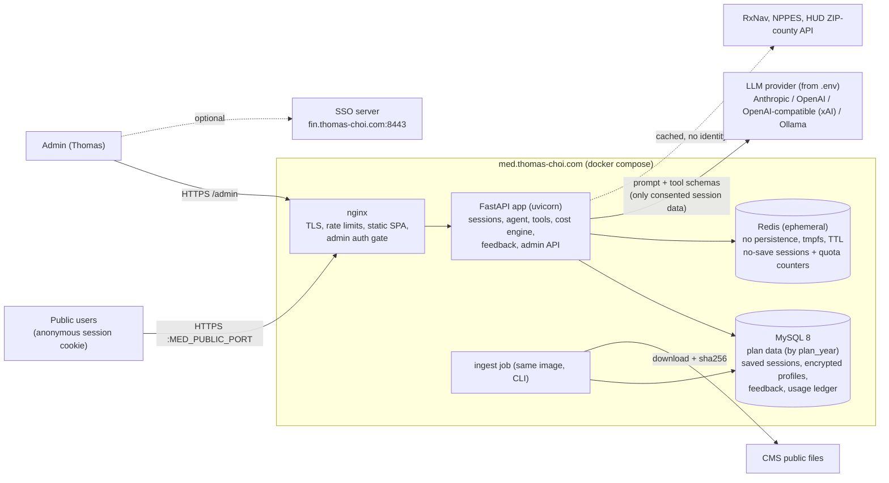
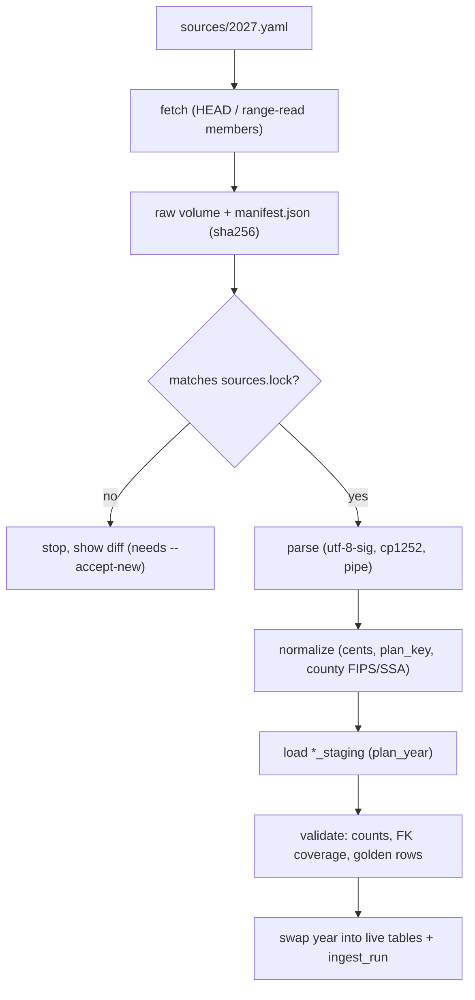

# Medicare Plan Selector: Technical Design v0.3

Repo: https://github.com/thomas-choi/medicare-plan-selector (**public**). Service: `https://med.thomas-choi.com:<MED_PUBLIC_PORT>` (**public, multi-user**).
Status: **Signed off by Thomas 2026-11-12 with the no-save addition** (§8.5). Defaults in OPEN-QUESTIONS are accepted unless Thomas objects. Author: Philip. Implementer: Claude Code worker. Date: 2026-11-12 (MST, America/Phoenix).

Key dates:
- Open Enrollment for plan year 2027 ends **Dec 7, 2026**.
- MVP: **Tue Nov 17**.
- Cloud test deploy: **Wed Nov 18**.
- Thomas enrolls by **Tue Nov 24**.

> **Shown on every page and in every export:**
> - This is an independent, free comparison tool. It is **not a licensed insurance agent or broker** and is **not affiliated with or endorsed by CMS, Medicare or any plan**.
> - It earns no commissions.
> - Costs are **estimates**. Confirm on [Medicare Plan Finder](https://www.medicare.gov/plan-compare/), at 1-800-MEDICARE (1-800-633-4227), or with your state's SHIP counselor ([shiphelp.org/local-medicare-help](https://www.shiphelp.org/local-medicare-help), 1-877-839-2675).

---

## 1. Goals and non-goals

**Goals**
1. **Anyone can use it, with no account.** A user describes their needs in a few lines (ZIP, coverage path, drugs, doctors, budget, must-haves). The agent loads the official CMS data for their county, then asks focused questions to narrow the list to a cited top 3.
2. A comparison canvas shows:
   - a sortable table;
   - a cost chart;
   - a side-by-side detail view;
   - a verification checklist.
3. **Feedback collection.** All feedback on plan choice is collected (§7) and used to improve prompts and tests.
4. **Yearly reuse.** Each year means a `plan_year` value plus a re-ingest.
5. **Open source** in a public repo. No secrets and no personal data ever go in git.

**Non-goals for v1**
- Enrollment, lead generation, plan-sponsored placement, or any commission.
- Scraping Medicare.gov.
- Guaranteed network accuracy.
- Exact parity with Plan Finder.
- User accounts. They are optional and come later.

---

## 2. Architecture



**Core rule (unchanged from v0.1).** The LLM never states a plan fact on its own. It calls deterministic tools, and those tools return rows carrying `src_ref` (source, vintage, row key). The chat and the canvas render the same tool results. A post-check validator rejects any number or plan ID that isn't in a tool output.

| Layer | Choice |
|---|---|
| Frontend | React 18 + TypeScript + Vite, TanStack Table, Recharts. Built as static files and served by nginx. |
| Backend | **FastAPI** (Python 3.12, Pydantic v2). SSE streaming for chat. |
| DB | **MySQL 8** (Thomas's cloud). SQLAlchemy 2 + **Alembic** migrations. |
| Deploy | Docker images + `docker compose` + nginx TLS (Thomas's existing pattern). |
| LLM | Provider abstraction configured in `.env` (§6.4). |

---

## 3. Data sources

These are unchanged from v0.1 §3. **V** means verified on 2026-11-12. **D** means documented but not yet inspected. **U** means unverified.

| # | Source | Status |
|---|---|---|
| S1 | CMS Landscape CY2027 (202611): https://www.cms.gov/files/zip/cy2027-landscape-202611.zip | **V**: sha256 `0b479aa3…210f62f`; columns inspected |
| S2 | PBP Benefits 2027: https://www.cms.gov/files/zip/pbp-benefits-2027.zip | **V** (HEAD only). Field mapping is **U**. |
| S3 | Monthly Part D formulary files CY2027: https://data.cms.gov/sites/default/files/2026-10/73ce0d29-e440-4d9a-9608-93678a50e8c8/2027_20261008.zip | **V**: members listed by range read. **No pricing file.** |
| S4 | Quarterly SPUF with pricing. Latest is CY2026 (`SPUF_2026_20261007`); CY2027 is expected in January 2027. https://data.cms.gov/provider-summary-by-type-of-service/medicare-part-d-prescribers/quarterly-prescription-drug-plan-formulary-pharmacy-network-and-pricing-information | **D/V** |
| S5 | 2027 Star Ratings tables: https://www.cms.gov/files/zip/2027-star-ratings-data-tables-oct-8-2026.zip | **V** (HEAD) |
| S6 | 2027 Part D standard deductible $700 and OOP threshold $2,400: https://www.cms.gov/files/document/2027-announcement.pdf | **V** |
| S7 | 2027 Part B premium and deductible | **TBD**. Not found as of 2026-11-12. |
| S8 | Plan Finder | No official public API found. Not scraped. |
| S9 | Medigap: AZ SHIP booklet https://azship.org/wp-content/uploads/2026/09/2026-Q4-Medigap-Booklet.pdf; no CMS bulk data | **V** (PDF). Post-MVP. |
| S10 | RxNorm API: https://lhncbc.nlm.nih.gov/RxNav/APIs/RxNormAPIs.html | **V** (live call) |
| S11 | NPPES API v2.1: https://npiregistry.cms.hhs.gov/api-page | **V** (live call) |
| S12 | HUD USPS ZIP crosswalk API (`type=2` = zip-county): https://www.huduser.gov/portal/dataset/uspszip-api.html | **V** (page read). See `HUD-API-SETUP.md`. |

**Licensing of redistributed data:**
- CMS data is a US Government work.
- The Part D files come with a CMS "Terms and Conditions for Use" document that is linked from the Files-for-Order page. **U**: read it before showing the data publicly, during M1.
- Raw files are **never committed**. Only small public fixture samples are, with attribution in `DATA-SOURCES.md`.

**Known gaps (shown in the UI):**
- Provider networks are not in CMS PUFs, so the tool produces a call-to-verify checklist.
- 2027 drug prices are proxies until January 2027.
- SNPs are hidden unless the user says they qualify.

---

## 4. Ingestion (per `plan_year`)

The pipeline is the same as v0.1 §4: fetch with HEAD and range reads, write a `manifest.json` with sha256 values, pin them in `sources.lock`, parse, normalize, validate, and record an `ingest_run`.

**What changes for MySQL:**
- Plan-data tables carry `plan_year SMALLINT NOT NULL` as the first column of the primary key or the index.
- Each load goes into a `*_staging` table and is swapped in with `RENAME TABLE`, or by delete-and-insert inside one transaction for that year. Other years are untouched.
- Optionally, `PARTITION BY LIST (plan_year)` on the largest tables (`formulary`, `tier_cost`). Decide in M1 based on row counts.
- Ingest runs as `docker compose run --rm ingest advisor ingest --year 2027` with a DB user that has write access to plan tables only. The API runtime user has **read-only** access to plan tables.



---

## 5. Data model (MySQL, utf8mb4)

**Public plan data.** Every table is keyed by `plan_year`, and every row has `src_ref`.
```
ingest_run(id, plan_year, source_id, url, vintage, sha256, rows, status, started_at, finished_at)
county(fips PK, ssa_code, state, name, ma_region_code, pdp_region_code)
zip_county_cache(zip, fips, res_ratio, hud_year, hud_quarter, fetched_at)      -- ZIP+county only, no user link
plan(plan_year, plan_key, contract_id, plan_id, segment_id, category, plan_type, org_marketing_name,
     plan_name, snp_type, sanctioned, part_c_premium_cents, part_d_total_premium_cents,
     part_d_deductible_cents, moop_in_network_cents, star_overall, star_part_c, star_part_d, src_ref,
     PRIMARY KEY(plan_year, plan_key))
plan_county(plan_year, plan_key, fips)
pbp_benefit(plan_year, plan_key, service_code, copay_cents, coins_pct, notes, src_ref)
formulary(plan_year, formulary_id, ndc, rxcui, tier, prior_auth, step, qty_limit, qty_amount, qty_days, src_ref)
plan_formulary(plan_year, plan_key, formulary_id)
tier_cost(plan_year, plan_key, tier, phase, pharmacy_type, days_supply, copay_cents, coins_pct, src_ref)
insulin_cost(plan_year, plan_key, tier, pharmacy_type, days_supply, copay_cents, src_ref)
drug_price_proxy(plan_year, plan_key NULL, ndc, days_supply, unit_cost_milli, source_year, src_ref)
part_d_params(plan_year PK, std_deductible_cents, oop_threshold_cents, src_ref)
```

**User and session data, saved mode only.** No-save sessions never write these tables (§8.5). The one exception is a team message the user explicitly submits, which goes into `feedback` with `session_id = NULL`. Encrypted fields are marked 🔒.
```
session(id_hash PK, created_at, last_seen_at, expires_at, consent_version, consent_profile BOOL,
        consent_feedback_phi BOOL, plan_year, ip_prefix_hash, deleted_at)
profile(session_id, county_fips, path, budget_json, utilization_json, must_haves_json,
        zip_enc 🔒, drugs_enc 🔒, providers_enc 🔒, key_version)
chat_msg(session_id, seq, role, content_enc 🔒, tool_calls_json, model_id, tokens_in, tokens_out, created_at)
recommendation(id, session_id, plan_year, rank, plan_key, est_total_cents, worst_case_cents,
               weights_json, data_vintage, created_at)                      -- no PHI
feedback(id, session_id NULL, kind, recommendation_id NULL, rating NULL, thumbs NULL,
         chosen_plan_key NULL, enrolled BOOL NULL, text_redacted, text_raw_enc 🔒 NULL,
         phi_opt_in BOOL, mode ENUM('saved','nosave'), app_version, prompt_version, model_id, created_at, triage_status, triage_note)
usage_ledger(  -- saved mode only
  day, session_id_hash, ip_prefix_hash, provider, model, tokens_in, tokens_out, cost_micro_usd)
usage_daily(day, provider, model, mode, tokens_in, tokens_out, cost_micro_usd)   -- all modes, no linkage
feedback_counter(day, plan_year, kind, value, prompt_version, model_id, count)   -- no-save inline feedback
consent_log(session_id, consent_version, choice_json, created_at)
admin_audit(id, admin_subject, action, target, created_at)
```

**Encryption:**
- 🔒 fields use AES-256-GCM at the application layer (Python `cryptography`).
- The key comes from `PROFILE_ENC_KEY` (base64, 32 bytes) in the server `.env`. `key_version` is stored with each row to allow rotation.
- Optionally, InnoDB tablespace encryption and an encrypted volume for defense in depth. This depends on Thomas's host (**U**).
- Who can decrypt:
  - **Encrypted chat content** is decrypted only for the owning session's own view.
  - **Admins** see only redacted text. Decryption for admins happens only when the user opted in (`phi_opt_in`), and that access is logged in `admin_audit`.

---

## 6. Agent, cost engine, LLM providers

### 6.1 Cost engine
Unchanged from v0.1 §5:
- 12-month Part D phase simulation (plan deductible → tier cost share → $0 after $2,400 TrOOP, which is 2027 **V**);
- MA medical copays capped at MOOP;
- the price-source order: user-entered price → CY2026 same-plan proxy → state median proxy → range plus "check Plan Finder".

Approximation limits are shown under every estimate.

**Medigap:** **post-MVP** (manual quotes and AZ SHIP data).

### 6.2 Tools
These are unchanged from v0.1, plus `record_feedback`:
- `resolve_location`
- `resolve_drug`
- `lookup_provider`
- `search_plans`
- `filter_plans`
- `estimate_costs`
- `compare_plans`
- `explain_plan`
- `update_canvas`
- `record_feedback`

Every output includes `src_ref[]`, `plan_year` and `data_vintage`.

**Session scoping:** `session_id` is injected by the server, **never** supplied by the LLM. Tools can only read the current session's profile.

### 6.3 Conversation and neutrality
- **Intake slots** are filled per user: ZIP→county, path (MA / Original+PDP / both, default both), drugs, doctors, budget, utilization preset, pharmacy preference, must-haves, SNP eligibility (default no), and current plan (optional).
- **Neutral ranking:**
  - The score is a function only of the user's stated weights over estimated total cost, worst-case cost, stars and must-have fit.
  - There are **no sponsor fields, paid placement or carrier boosts** anywhere in the schema.
  - Ties break by `plan_key` so the order is deterministic.
  - The ranking code and weights are public in the repo and shown in the UI ("Why this order?").
- **Guardrails:**
  - Never invent facts; only cite tool rows.
  - Never claim network status.
  - Never discourage users from calling 1-800-MEDICARE, SHIP or the plan.
  - Never say "best plan" without the estimate disclaimer.

### 6.4 LLM provider abstraction (`.env`)
```
LLM_PROVIDER=anthropic            # anthropic | openai | openai_compat | ollama
LLM_MODEL=<model id>              # pinned; recorded per message (model_id)
LLM_BASE_URL=                     # openai_compat only (e.g., xAI or other OpenAI-compatible endpoint), ollama base URL
ANTHROPIC_API_KEY=  OPENAI_API_KEY=  OPENAI_COMPAT_API_KEY=
LLM_FALLBACK_PROVIDER=  LLM_FALLBACK_MODEL=   # used on 5xx/timeout/rate-limit; never on validator failure
LLM_TIMEOUT_S=60  LLM_MAX_OUTPUT_TOKENS=1500  LLM_TEMPERATURE=0.2
LLM_PRICE_IN_PER_MTOK_USD=  LLM_PRICE_OUT_PER_MTOK_USD=   # for the cost ledger/budget cap
```
- There is one `ChatProvider` interface: `complete(messages, tools) -> {text, tool_calls, usage}`.
- The adapters are `anthropic` (Messages API tool use), `openai` (Chat Completions/Responses function calling), `openai_compat` (the OpenAI adapter with a different `base_url` and key) and `ollama`. The exact endpoints for xAI and other providers are **U** and must be checked against each provider's docs in M3.
- Contract tests run every adapter against recorded fixtures.
- Model choice is Thomas's operational decision. The repo ships no default key.

---

## 7. Feedback subsystem

| Kind | Where captured | Fields |
|---|---|---|
| `recommendation_rating` | Thumbs up/down plus a 1–5 rating on each top-3 card and on side-by-side rows | `recommendation_id`, thumbs, rating, optional text |
| `session_outcome` | A "What did you decide?" card at the end, plus an optional return link (`/outcome/<token>`, no login) | `chosen_plan_key` (from the user's list, or "other" or "undecided"), `enrolled` (yes, no or planned), how confident they are, optional text |
| `general` | Feedback button in the header | text, optional rating |
| `bug` | "Report a problem" | text, page and view state, app/prompt/model version, last tool-call IDs (no message content) |

**Consent and PHI:**
- Feedback is optional and asked for after a short consent notice.
- Free text goes through a **PHI redactor** before storage in `text_redacted`. The redactor removes drug names (matched with an RxNorm lexicon), NPI-like or phone-like numbers, ZIPs, emails, dates of birth and names after "Dr.".
- Raw text is kept (encrypted) **only if** the user ticks "Include my details so the team can reproduce this".
- No PHI is attached automatically, and chat logs are never attached unless the user opts in.

**Admin view (`/admin`):**
- Filterable list by kind, rating, date, model and prompt version.
- Aggregates: thumbs rate, outcome distribution, top complaint tags.
- Triage status (`new → accepted → test-added → closed`).
- **CSV/JSON export** of redacted fields only.
- Every admin action is written to `admin_audit`.

**Closing the loop:**
- Thomas or the worker turns accepted items into regression fixtures under `tests/fixtures/feedback/`. These are anonymized and hand-written; raw user text is never copied.
- They also become prompt changes, bumping `prompt_version`.
- Feedback text is **never** fed back into the LLM automatically, which also prevents prompt injection through feedback.

---

## 8. Privacy, security, compliance

### 8.1 Data handling
- **Anonymous by default.**
  - The session ID is a random 256-bit value in an `HttpOnly; Secure; SameSite=Lax` cookie. Only its SHA-256 is stored.
  - Optional accounts (email or OAuth) are post-MVP.
- **Consent screen:** the user picks **No-save** (§8.5) or **Save for `RETENTION_DAYS`**. The default is set by `DEFAULT_SESSION_MODE`, and it is **No-save** unless Thomas changes it. The consent screen must be shown before anything is saved. It says what is stored, for how long, and which third parties receive it (the chosen LLM provider, and RxNav, NPPES and HUD without identity). Declining consent is the same as No-save mode.
- **Retention:**
  - Profiles and chat are deleted after `RETENTION_DAYS` of inactivity. The default is 30; see OPEN-QUESTIONS.
  - A nightly purge job does this.
  - Redacted feedback and `recommendation` rows (no PHI) are kept for analysis.
- **Delete my data:** a button, plus `DELETE /api/session` with the cookie. It hard-deletes the profile, chat, encrypted feedback text and the cookie. A confirmation message is shown.
- **Never logged:**
  - Request and response bodies of `/api/chat`, `/api/profile` and `/api/feedback` are excluded from access and app logs.
  - Structured logs use an allowlist of fields.
  - Errors are reported without payloads.
  - nginx `access_log` uses a format without query strings, and logs IP prefixes only.
- **Secrets:** everything in the server `.env` (mode 600, outside the repo). `.env.example` contains placeholders only.

### 8.2 Abuse and cost controls
- **nginx `limit_req`:** for example 30 req/min/IP on `/api`, and 6 req/min/IP on `/api/chat`. `limit_conn` caps open SSE streams.
- **App quotas, tracked in `usage_ledger`:**
  - `MAX_TURNS_PER_SESSION` (default 40);
  - `MAX_TOKENS_PER_SESSION`;
  - `MAX_SESSIONS_PER_IP_PER_DAY`;
  - a **global `LLM_DAILY_BUDGET_USD`** hard cap.
- When the cap is reached, chat is disabled with a notice and **the no-LLM comparison mode keeps working**: users fill a form and get the table.
- An optional **captcha** is triggered on new sessions or after quota warnings: Cloudflare Turnstile or hCaptcha, `CAPTCHA_PROVIDER=none|turnstile|hcaptcha`.
- Input limits: 2,000 characters per message, 30 drugs, 15 providers.

### 8.3 Prompt-injection defenses
- User text is wrapped as data in the prompt.
- The system prompt forbids tool calls the user didn't need for their stated task.
- **Tools are read-only.** None fetches arbitrary URLs, runs code or reaches other sessions.
- Tool arguments are schema-validated and server-bounded, for example at most 5 plans in a compare.
- CMS text fields (plan names) are escaped and never treated as instructions.
- The output validator applies the number and plan-ID check plus a policy check: no enrollment promises, no network claims, no medical advice.
- Red-team regression tests cover "ignore previous instructions", "show other users' data", "rank Humana first", and markdown or link injection.
- The frontend renders model output as sanitized markdown with no raw HTML, and external links are allowlisted to medicare.gov, cms.gov and shiphelp.org.

### 8.4 Regulatory notes
This is not legal advice. Thomas should consult counsel before a broad launch.

| Topic | Reading | Status |
|---|---|---|
| **HIPAA** | HIPAA applies to covered entities (health plans, clearinghouses, and providers doing standard electronic transactions) and their business associates. See 45 CFR 160.103 (https://www.ecfr.gov/current/title-45/subtitle-A/subchapter-C/part-160/subpart-A/section-160.103) and HHS (https://www.hhs.gov/hipaa/for-professionals/covered-entities/index.html). A free consumer comparison tool that isn't acting for a plan or provider **appears not to be** a covered entity or business associate. | Our reading; **unverified, consult counsel**. We still treat the data as sensitive. |
| **FTC Health Breach Notification Rule** (16 CFR 318, amended effective 2024-07-29) | It applies to "vendors of personal health records": non-HIPAA entities whose record of identifiable health information can draw from **multiple sources** and is managed primarily by or for the individual. See https://www.federalregister.gov/documents/2024/05/30/2024-10855/health-breach-notification-rule. Our app combines user-entered drugs with RxNav and NPPES lookups. **It may be in scope.** | **Unverified.** The design assumes the rule *may* apply. Section 8.1 minimizes data, there is an incident-response runbook in `SECURITY.md` (notify individuals and the FTC; the media if 500+ residents of a state are affected), and no data is shared with ad or analytics vendors. |
| **CMS MA communication/marketing rules** (42 CFR 422 Subpart V; 423 Subpart V for Part D) | "Marketing" is defined for MA organizations' communications (422.2260). A **TPMO** is an organization or person "**compensated** to perform lead generation, marketing, sales, and enrollment related functions." See https://www.ecfr.gov/current/title-42/chapter-IV/subchapter-B/part-422/subpart-V/section-422.2260. An uncompensated, unaffiliated tool with no plan relationship **likely falls outside** these rules. | **Unverified.** To stay clearly outside them: no commissions, lead sales, referral fees or plan sponsorships; no collection of contact info for plans; no "click to enroll"; links go only to Medicare.gov, SHIP and the plan's public phone number. All plans in the county are shown; none are hidden for business reasons. Revisit if any money or plan relationship appears. |
| **State insurance producer licensing** | Recommending plans could be argued to be "soliciting". Neutral, unpaid, informational tools are commonly treated differently. | **Unverified.** Consult counsel. Keep the wording "compare" and "estimate", never "sell" or "enroll". |
| **Accessibility** | Older-adult audience: target WCAG 2.2 AA, large-text mode, keyboard navigation. | Design goal |

### 8.5 No-save (ephemeral) session mode

This was added at sign-off. Choosing No-save means **we keep nothing about you on our servers after the session ends.**

| Aspect | No-save behavior |
|---|---|
| **Selection** | Chosen on the consent screen. Preselected when `DEFAULT_SESSION_MODE=nosave` (the default). The choice is fixed for the session; switching starts a new session. The mode is held in the Redis session record and in a non-identifying flag in the cookie. |
| **Where data lives** | Profile (ZIP/county, drugs, doctors, budget, utilization), chat, LLM transcripts, tool results and recommendations live **only in Redis** under `eph:{sid_hash}:*`. Redis runs with `save ""`, `appendonly no` and `/data` on **tmpfs**. Each value is AES-GCM encrypted with a **per-session key** that lives only in the user's cookie (`HttpOnly; Secure`). The server holds ciphertext it can't read once the cookie is gone. |
| **No MySQL** | No rows go into `session`, `profile`, `chat_msg`, `recommendation`, `consent_log` or `feedback`, apart from the opt-in described under Feedback below. This is enforced in code: `SessionStore` has two implementations, `MySQLSessionStore` and `EphemeralSessionStore`. A SQLAlchemy `before_cursor_execute` guard **raises** if an INSERT, UPDATE or DELETE hits a user table while the request context is in no-save mode. |
| **No disk** | There is no file cache of profile data. No-save chat doesn't use the HUD/RxNav/NPPES caches that hold user-linked data (those caches are already user-agnostic: ZIP→FIPS, drug name→RxCUI). `uvicorn` has no request-body logging. Core dumps are disabled in the container (`ulimit -c 0`). |
| **Wipe triggers** | (1) An **"End session & erase"** button sends `DELETE /api/session`, which deletes every `eph:{sid}:*` key and clears the cookie. (2) **Idle timeout:** a sliding TTL of `EPHEMERAL_IDLE_MINUTES` (default **30**) on every key. (3) **Absolute cap:** `EPHEMERAL_MAX_HOURS` (default **4**). (4) **Tab close:** a best-effort `navigator.sendBeacon` on `pagehide`; the TTL covers the case where it doesn't fire. (5) **Restart:** the API deletes all `eph:*` keys at startup, and Redis restarts empty because it has no persistence. |
| **Logs** | The same field allowlist as saved mode, plus no session-ID hash in logs (only a random per-request ID). No ZIP, drug or doctor text appears anywhere. |
| **Browser** | No `localStorage` or IndexedDB of profile data in either mode. The SPA keeps state in memory only. Before ending, the user can **download their comparison** (Markdown or PDF generated client-side), because we won't keep it. |
| **Feedback** | Inline 👍/👎 and the outcome picker only **increment anonymous counters** in `feedback_counter(day, plan_year, kind, value, prompt_version, model_id, count)`. There is no session link, no plan link for ratings, and no text. The outcome can count `chosen_plan_key` per day with no session link. Free text is **off** in the inline widgets. A separate **"Send a message to the team"** form is available. Before submitting it says: *"This message will be stored (redacted) for up to 365 days and is not linked to your session."* Submitted messages are stored under the normal feedback rules with `session_id = NULL` and `mode = 'nosave'`. |
| **Cost ledger** | `usage_daily(day, provider, model, mode, tokens_in, tokens_out, cost_micro_usd)` is aggregated with **no session or IP linkage**. Per-session and per-IP quotas run in Redis only. The IP key is an HMAC with a daily-rotating salt and a TTL of 24 hours. |
| **LLM provider** | Our no-save promise covers **our** servers. The LLM provider's own retention policy still applies, and the consent screen says so and names the provider. Where a provider offers a zero-retention or no-training setting, use it (**U**: depends on the provider and account). Ollama keeps everything on the host. |
| **What saved mode adds** | Resuming a session later, the session-outcome link, linked ratings with text, and the admin's per-session view. |

The trade-off is visible in the UI: *"No-save: nothing is kept on our servers after you finish or after 30 minutes idle. You can download your comparison first."*

---

## 9. Frontend
- **Chat** on the left, using SSE, with citation chips.
- **Canvas** on the right, with four tabs:
  - **Table:** sortable; dropped plans are greyed out with the reason.
  - **Cost chart:** stacked bars with a worst-case marker.
  - **Side-by-side:** 2–5 plans.
  - **Checklist:** confirm in Plan Finder, call the plan about doctors, optional SHIP review.
- **Feedback controls** on each recommendation card.
- Consent (No-save vs Save), disclaimer, delete-my-data and "End session & erase" are reachable from every page. A mode badge is always visible.
- **No-LLM mode:** a form plus the table only. Used as the fallback and when the budget cap is reached.
- **No third-party analytics by default** (OPEN-QUESTIONS Q5).

---

## 10. Deployment (med.thomas-choi.com)

**docker compose services:**
- `nginx`: TLS termination, SPA static files, `/api` proxy, rate limits, `/admin` gate.
- `api`: FastAPI on uvicorn, 2 workers.
- `ingest`: one-shot job, same image.
- `purge`: daily cron or scheduler, deletes expired saved sessions.
- `redis`: `redis:7` with `--save "" --appendonly no`, `/data` on tmpfs, a `maxmemory` limit with `volatile-ttl` eviction, an internal network only, and a password from `.env` (`REDIS_URL`).
- `mysql`: either a container with a volume, or Thomas's existing MySQL.

**Network and TLS:**
- **Port:** `MED_PUBLIC_PORT` in `.env`; nginx listens there.
- **Certificates:** Let's Encrypt HTTP-01 validation requires port 80 to be reachable. Without port 80, use DNS-01 or an existing wildcard certificate for `*.thomas-choi.com` (**U**: depends on how the fin host is set up).
- HSTS, CSP (`default-src 'self'`), `X-Content-Type-Options`, `Referrer-Policy: no-referrer`.

**Admin auth options** (OPEN-QUESTIONS Q2):
- **(A) MVP:** nginx basic auth plus an IP allowlist on `/admin`, with credentials stored hashed on the server.
- **(B) Post-MVP:** SSO via `fin.thomas-choi.com:8443`, reusing the FUND SSO client pattern and a dedicated permission such as `application.medicare_admin`. Public users never touch SSO.

**Operations:**
- **Backups:** nightly `mysqldump` of non-plan tables, encrypted. Plan data can be rebuilt from CMS.
- **Releases:** the image is tagged by git SHA and recorded in `feedback.app_version`.
- **Deploy approval:** a deploy or push happens only with Thomas's explicit approval, as in his standing workflow.

---

## 11. Public repo hygiene
- **Files:**
  - `LICENSE` (OPEN-QUESTIONS Q1);
  - `SECURITY.md` (private reporting via GitHub Security Advisories, plus the breach runbook);
  - `CONTRIBUTING.md` (tests required; no real user data in issues or fixtures);
  - `CODE_OF_CONDUCT.md` (optional);
  - `.env.example`;
  - `DATA-SOURCES.md` (CMS attribution and disclaimers).
- **Secret scanning:**
  - `pre-commit` with `gitleaks` (or `detect-secrets`), `ruff`, `mypy`, `eslint`, `prettier`;
  - a hook that blocks `data/`, `*.sqlite`, `*.zip` and `.env*` except `.env.example`;
  - GitHub secret scanning and push protection turned on in repo settings, which Thomas does himself.
- **CI:** GitHub Actions runs the test suite only. It uses no secrets, and LLM tests use the fake provider.

---

## 12. Repo layout (`medicare-plan-selector/`)
```
README.md LICENSE(GPL-3.0, already in repo) SECURITY.md CONTRIBUTING.md DATA-SOURCES.md .env.example .gitignore .pre-commit-config.yaml
docker-compose.yml docker-compose.prod.yml Makefile
deploy/nginx/med.conf.template  deploy/README.md
docs/CLAUDE-HANDOFF.md  docs/design/{README,DESIGN,IMPLEMENTATION-PLAN,HUD-API-SETUP,OPEN-QUESTIONS,CHANGES-FROM-v0.1,CHANGES-FROM-v0.2}.md
sources/2027.yaml sources.lock
backend/pyproject.toml  backend/alembic/  backend/selector/
  config.py db.py cli.py crypto.py redact.py quotas.py store/{base,mysql_store,ephemeral_store,write_guard}.py
  ingest/{fetch,remote_zip,manifest,normalize,validate}.py ingest/parsers/{landscape,pbp,spuf,stars,hud}.py
  cost/{part_d,medical,medigap,engine,params}.py
  agent/{orchestrator,tools,validator,policy}.py agent/prompts/ agent/providers/{anthropic,openai,openai_compat,ollama,fake}.py
  api/{main,chat,plans,profile,feedback,admin,session}.py
backend/tests/{unit,integration,contract,regression,redteam,nosave}/ backend/tests/fixtures/{cms/2027,golden,transcripts,feedback}/
frontend/src/{chat,canvas,feedback,consent,admin,nollm}/  frontend/tests/
```
